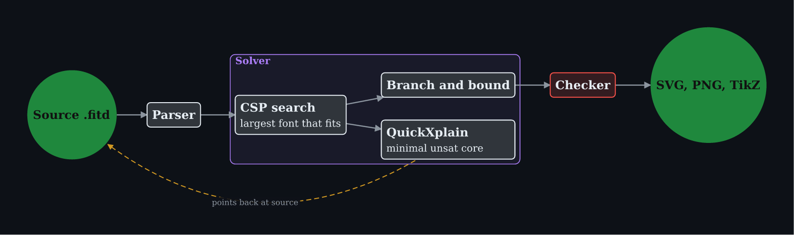
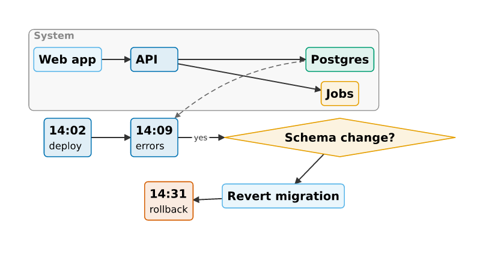
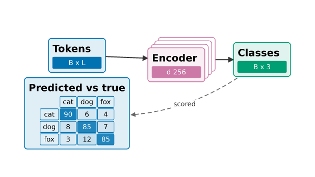
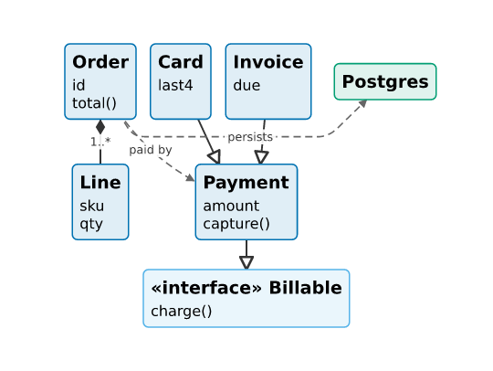
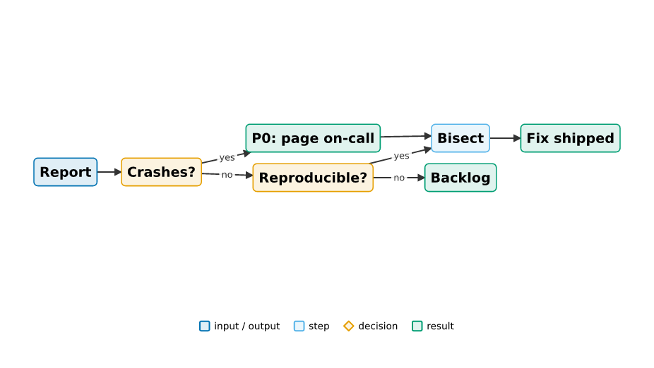

# fitd

[](https://github.com/WilliamMorales1/fitd/actions/workflows/ci.yml)

fitd is a text-based diagram compiler. It converts `.fitd` source into SVG, PNG, PDF, or TikZ and searches for a layout that satisfies declared constraints while maximizing font size on a fixed page.

```fitd
title "How fitd compiles a diagram"
layout layered dir=right
page 297x210mm margin=1cm

style io color=#009E73 shape=circle

io
  src "Source : fitd"
  out "SVG, PNG, TikZ"
parse "Parser"
csp "CSP search"
| largest font that fits
bnb "Branch and bound"
core "QuickXplain"
| minimal unsat core
checker "Checker" color=#F85149

src -> parse -> csp -> bnb, core
bnb -> checker -> out
core ..> src "points back at source"

group "Solver" csp, bnb, core color=#AB7DF7

require bnb above core gap=2em
prefer out at right weight=2
```



## Design goals

Every change to fitd, its standard library, or its docs is judged against these goals:

- Minimal code should produce a professional result. The compiler does most of the work.
- Sane defaults, with optional overrides.
- Deterministic: the same source always gives the same drawing.
- One second at most for most reasonable compilations.
- An expansive, reliable, and easy-to-use standard library.
- Source code should be readable.
- Diagrams carry the minimal amount of text.

[AGENTS.md](AGENTS.md) maps these goals onto the diagram types fitd covers and the work still planned.

## Installation

Requires Rust 1.85 or newer and Cargo.

```sh
cargo install --path .
```

Prebuilt binaries for Linux, macOS, and Windows are available from [GitHub Releases](https://github.com/WilliamMorales1/fitd/releases).

## Usage

```sh
fitd diagram.fitd -o diagram.svg
fitd diagram.fitd -o diagram.png
fitd diagram.fitd -o diagram.pdf
fitd diagram.fitd --tikz diagram.tex
fitd first.fitd second.fitd -o book.pdf
fitd guide
fitd explain E0110
```

Output format is selected from output filename extension. Multiple inputs with PDF output produce one page per input. Diagnostics are written to standard error. `--short` prints one line per diagnostic.

## Language

`.fitd` files contain one statement per line. Node declarations and edges form basic diagrams; optional statements configure page, typography, themes, groups, layouts, and constraints. The [language reference](docs/language.md) specifies grammar and semantics.

```fitd
input "Input"
check "Valid?"
output "Save"
input -> check
check -> output "yes"
require input left-of check gap=2em
```

## Documentation

- [Language reference](docs/language.md): grammar, statements, macros, semantics, diagnostics.
- [Options](docs/options.md): command-line options, themes, watch mode, split output.
- [Internals](docs/internals.md): solver and implementation details, testing, benchmarks.
- [Examples](examples/README.md): every example with its image.
- [Showcase](examples/showcase/): figures that combine several standard-library modules.
- [Gallery](examples/gallery/): one diagram per common academic figure type, built on the standard library.
- [Agent skill](skills/fitd/SKILL.md): instructions for generating diagrams with fitd.

## Gallery

Each image is built from the `.fitd` file beside it; the PNGs are committed and checked by the tests.

Standard-library modules combine in one figure. [examples/showcase](examples/showcase/) mixes `arch`, `time`, `flow`, `nn`, `grid`, `uml`, and `tree`:

| | |
| --- | --- |
| [](examples/showcase/01-incident-review.fitd) | [](examples/showcase/02-model-confusion.fitd) |
| [](examples/showcase/03-domain-model.fitd) | [](examples/showcase/04-triage.fitd) |

[examples/README.md](examples/README.md) shows every example. [examples/gallery](examples/gallery/) has one image per common academic figure type. [examples/out](examples/out/) has renders of the language examples: radial maps, layered flows, macros, and includes.

## Features

- Hard constraints through `require`; weighted preferences through `prefer`.
- Fixed-page layout with font-size search.
- Independent output checking for overlaps, crossings, clipping, and overflow.
- Macros for loops, conditions, templates, and interpolation.
- Source diagnostics and minimal conflicting sets for unsatisfiable constraints.
- Import support for Graphviz DOT, Mermaid, and D2.
- Language server and Tree-sitter and VS Code syntax support.

## Development

```sh
cargo test --release
```

`python3 bench/bench.py --check bench/baseline.tsv` checks deterministic solver-work baselines. Set `FITD_FUZZ_SECS` to extend the test fuzzer.
