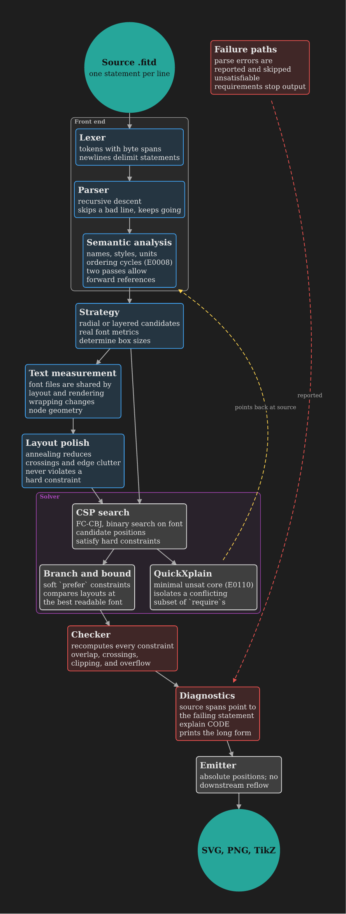

# fitd

A small diagram language with a constraint solver for layout. Write nodes, edges, and layout constraints in a plain text file; fitd finds the largest font that fits a fixed page, satisfies every `require`, trades off every `prefer`, then verifies the result before writing SVG, PNG, or TikZ.

```
title "How fitd compiles a diagram"
layout layered
page a3

node lex "Lexer"
| tokens with byte spans
node parse "Parser"
node bnb "Branch and bound"
node core "QuickXplain"

lex -> parse
parse -> bnb, core
core ..> lex "points back at source"

require bnb left-of core
require align row(bnb, core)
prefer core at bottom-right weight=2
```



## Usage

```fish
cargo build --release
./target/release/fitd examples/compiler.fitd -o docs/examples/compiler.png
./target/release/fitd examples/compiler.fitd --tikz out/compiler.tex
./target/release/fitd guide          # the language on one page
./target/release/fitd explain E0110  # explain an error code
./target/release/fitd examples/compiler.fitd --watch   # rebuild on save: draft, then full
./target/release/fitd split examples/group_theory.fitd  # overview plus one page per branch
```

Editors: `fitd lsp` is a language server (front-end diagnostics as you type, full layout on save, cancelled by a newer save, go-to-definition and completion for node and style names, including those from included files, whose diagnostics are published under their own names). `editors/vscode/` holds a TextMate grammar packaged as a VS Code extension; copy or symlink it into `~/.vscode/extensions/fitd` for highlighting. `editors/tree-sitter-fitd/` is a tree-sitter grammar with setup for Neovim and Helix.

Tests: `cargo test --release`.

## Compared with DOT, Mermaid, and D2

Those languages have far wider adoption and tooling; `fitd import` translates Graphviz (`.dot`), Mermaid flowcharts and mind maps (`.mmd`), and D2 (`.d2`): nodes, labels, edges, and clusters, subgraphs, or containers (as `group`), with a mind map's indentation becoming a radial tree; it lists whatever has no equivalent. What fitd adds:

- Hard constraints: `require a left-of b`, `align row(...)`, `a at top-left` hold in the output or the build fails.
- Weighted preferences: `prefer ... weight=N` trades soft wishes against each other explicitly.
- A fixed page, filled: the solver maximizes the font that fits the page you name, instead of growing the canvas.
- Verified output: an independent checker re-derives overlaps, crossings, clipping, and overflow from the finished drawing.
- Unsat cores at source lines: when `require`s conflict, a minimal conflicting set is reported, rustc style, at the lines that wrote them.

Why not a layout plugin for one of them instead? D2, Mermaid (v11 layouts), and Graphviz all accept external layout engines, but each measures text before layout and renders after it. A plugin receives boxes already sized, so it cannot search for the largest font that fits the page, and the checker would verify a drawing other than the one written. D2 also rejects unknown keywords and Mermaid has no attribute syntax, so `require` and `prefer` would live in comments. The language front end is about a quarter of the code; the solver and checker, which a plugin would cripple, are the rest.

## Docs

- [Language](docs/LANGUAGE.md): grammar, semantics, relations, diagnostics.
- [Options and theming](docs/OPTIONS.md): command-line flags, colors, fonts.
- [Agent skill](skills/fitd/SKILL.md): drawing diagrams with fitd from an AI agent.
- [Examples](docs/EXAMPLES.md): every example with its rendered output.
- [Internals](docs/INTERNALS.md): pipeline, solver, references, tests.
