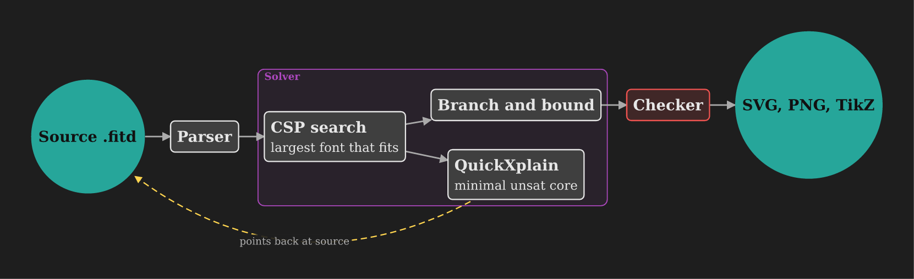

# fitd

[](https://github.com/WilliamMorales1/fitd/actions/workflows/ci.yml)

fitd is a text-based diagram compiler. It converts `.fitd` source into SVG, PNG, PDF, or TikZ and searches for a layout that satisfies declared constraints while maximizing font size on a fixed page.

```fitd
title "Photosynthesis"
layout radial root=leaf
page a4 portrait margin=12mm

node sun "Light"
node leaf "Leaf"
| converts light into stored energy
node sugar "Glucose"

sun -> leaf
leaf -> sugar "produces"
require sun above leaf
```

## Installation

Requires Rust 1.85 or newer and Cargo.

```sh
cargo install --path .
```

Prebuilt binaries for Linux, macOS, and Windows are available from [GitHub Releases](https://github.com/WilliamMorales1/fitd/releases).

## Usage

```sh
fitd diagram.fitd -o diagram.svg
fitd diagram.fitd -o diagram.png
fitd diagram.fitd -o diagram.pdf
fitd diagram.fitd --tikz diagram.tex
fitd first.fitd second.fitd -o book.pdf
fitd guide
fitd explain E0110
```

Output format is selected from output filename extension. Multiple inputs with PDF output produce one page per input. Diagnostics are written to standard error. `--short` prints one line per diagnostic.



## Language

`.fitd` files contain one statement per line. Node declarations and edges form basic diagrams; optional statements configure page, typography, themes, groups, layouts, and constraints. The [language reference](docs/language.md) specifies grammar and semantics.

```fitd
node input "Input"
node check "Valid?"
node output "Save"
input -> check
check -> output "yes"
require input left-of check gap=2em
```

## Documentation

- [Language reference](docs/language.md): grammar, statements, macros, semantics, diagnostics.
- [Options](docs/options.md): command-line options, themes, watch mode, split output.
- [Internals](docs/internals.md): solver and implementation details, testing, benchmarks.
- [Examples](examples/): source files demonstrating language features.
- [Agent skill](skills/fitd/SKILL.md): instructions for generating diagrams with fitd.

## Features

- Hard constraints through `require`; weighted preferences through `prefer`.
- Fixed-page layout with font-size search.
- Independent output checking for overlaps, crossings, clipping, and overflow.
- Macros for loops, conditions, templates, and interpolation.
- Source diagnostics and minimal conflicting sets for unsatisfiable constraints.
- Import support for Graphviz DOT, Mermaid, and D2.
- Language server and Tree-sitter and VS Code syntax support.

## Development

```sh
cargo test --release
```

`python3 bench/bench.py --check bench/baseline.tsv` checks deterministic solver-work baselines. Set `FITD_FUZZ_SECS` to extend the test fuzzer.
