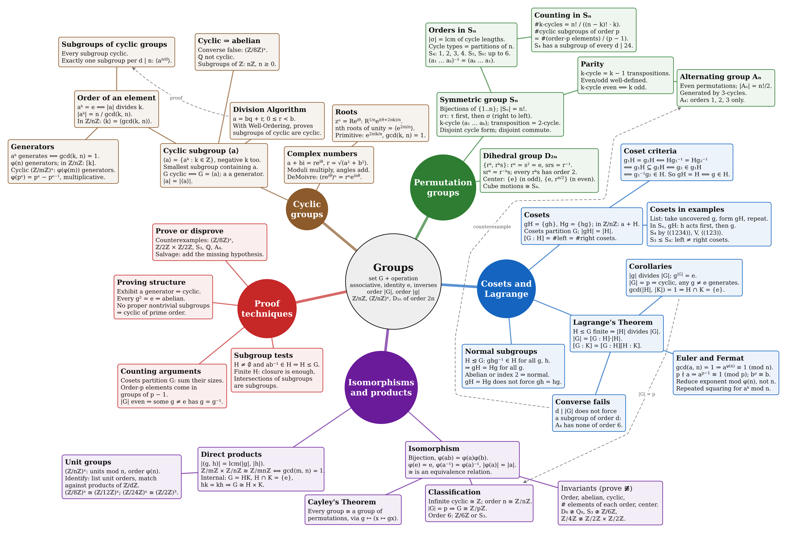
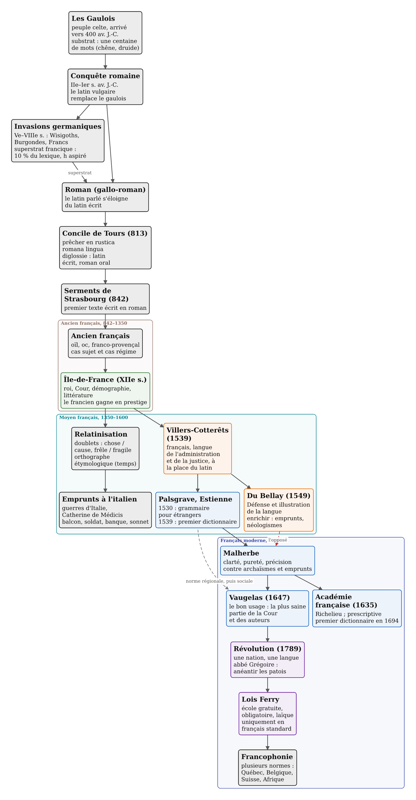
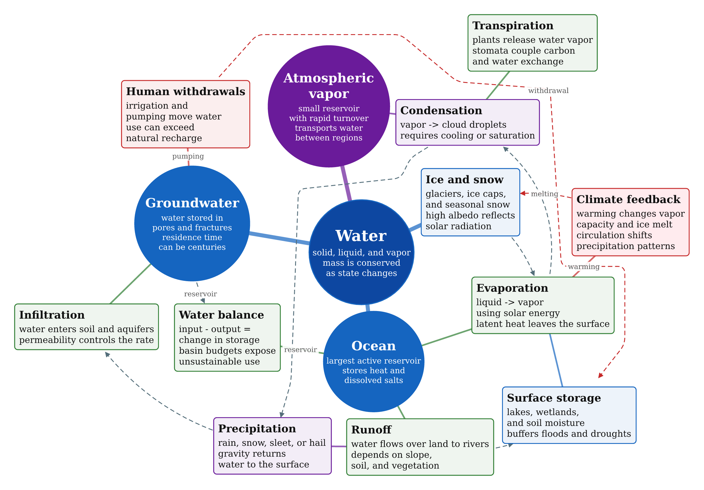
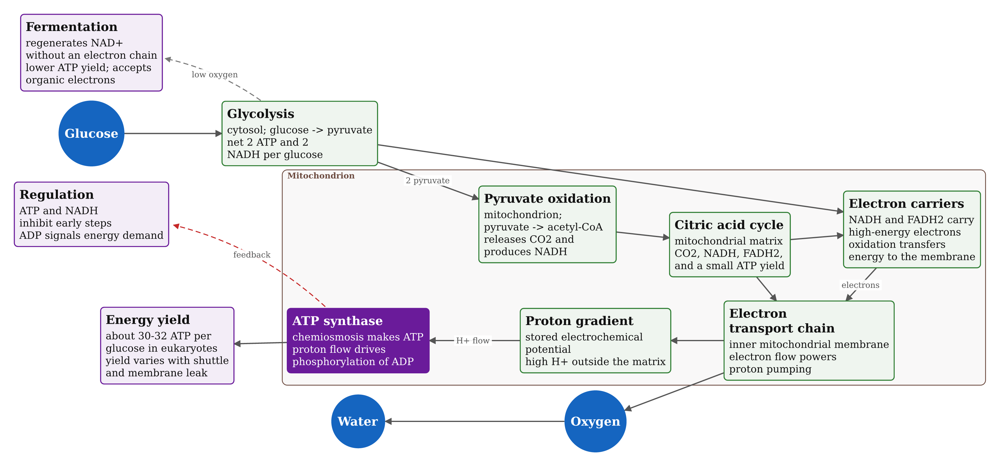

# Examples

Each image is the PNG output of the file above it, built with no flags.

## [`group_theory.fitd`](../examples/group_theory.fitd)

Group theory notes with no settings at all: a large radial map on the defaults, with bodies, math markup, and cross links.



## [`french_history.fitd`](../examples/french_history.fitd)

Real course notes: a layered timeline (down) on a portrait page, colored `group` frames per period, styles, a colored link, `require ... at` and `prefer ... at`.



## [`earth_science.fitd`](../examples/earth_science.fitd)

Radial map: `root=`, theme overrides (`root=`, `link=`), styles on nodes and edges, a node `fill`, labeled links, `require` and `prefer`.



## [`compiler.fitd`](../examples/compiler.fitd)

Layered flowchart (down): `theme dark`, `page ... margin=`, `shape=circle` terminals, two groups, a row alignment, `gap=`, `near ... within=`.


## [`cell_biology.fitd`](../examples/cell_biology.fitd)

Layered flowchart (right) that wraps into two bands: a group frame, circle molecules, a solid `fill` (text turns white), labeled arrows, an edge `color=`.



## Rebuilding

After a change to layout or drawing, rebuild every image (fish):

```fish
for f in examples/*.fitd; ./target/release/fitd $f -o docs/examples/(basename $f .fitd).png; end
```
