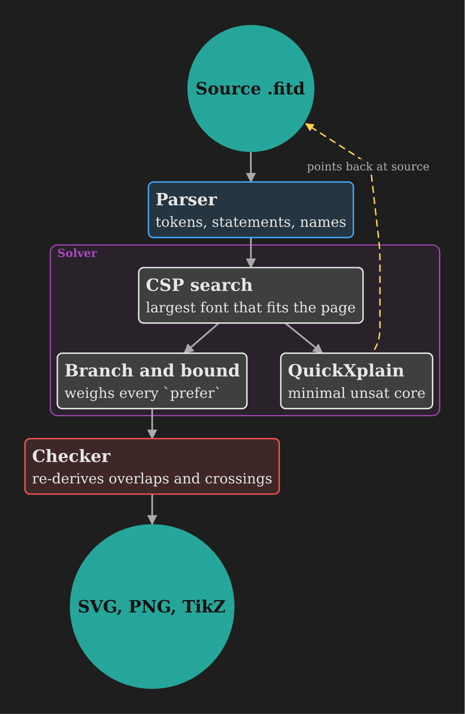
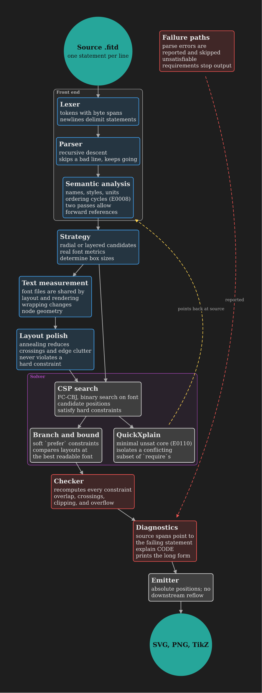
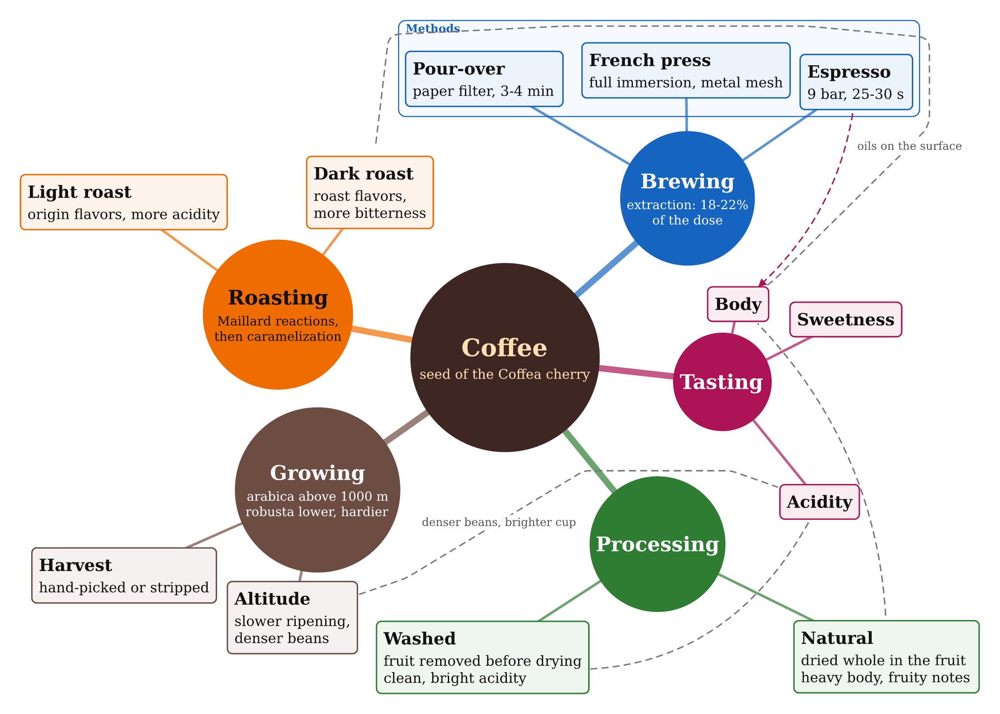
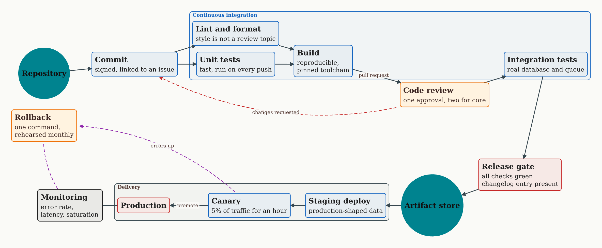
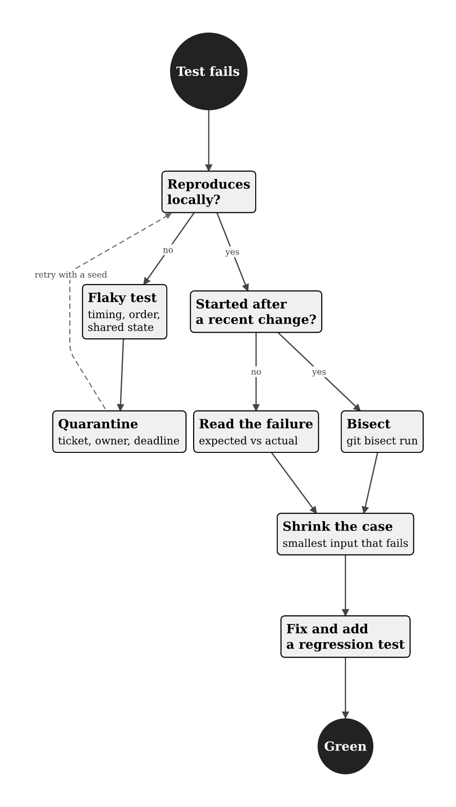
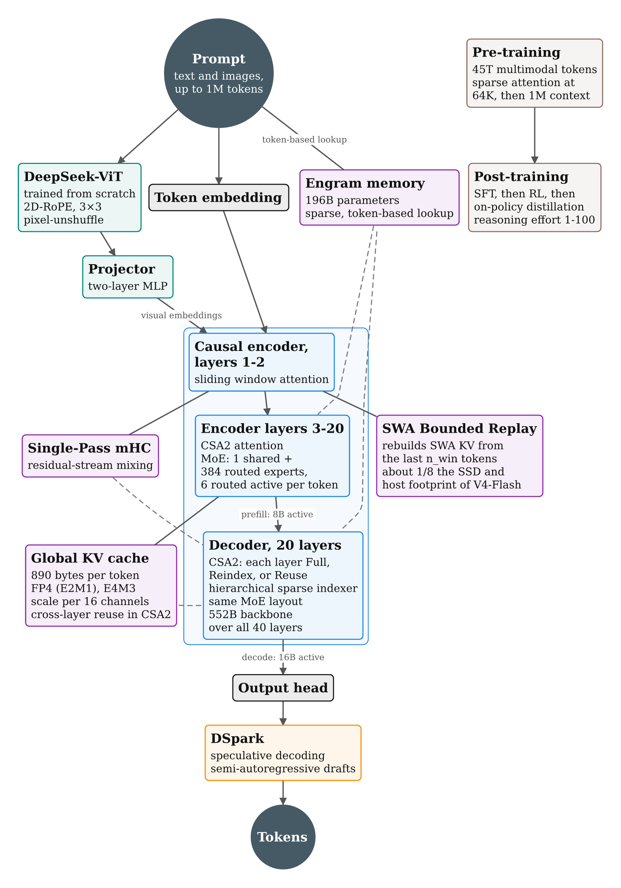
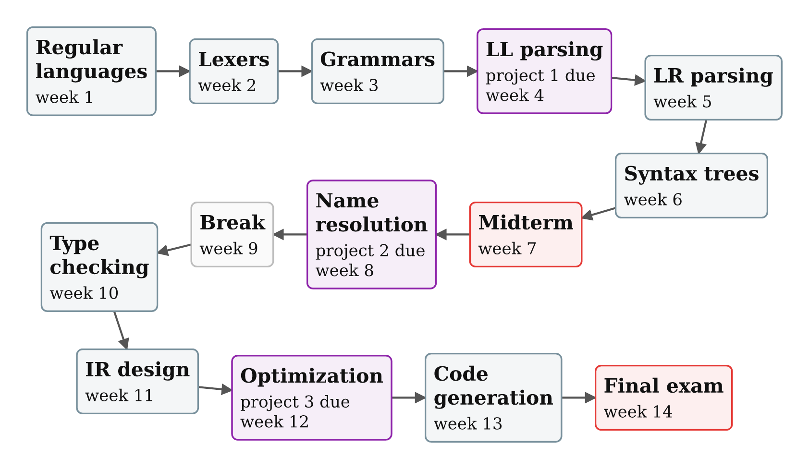
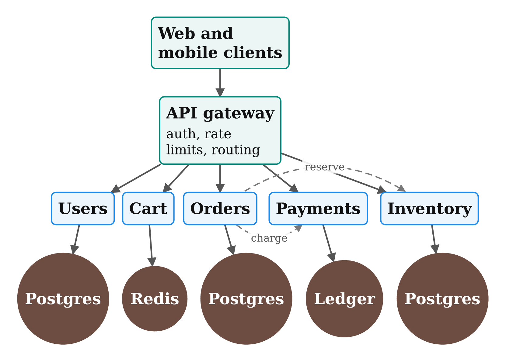
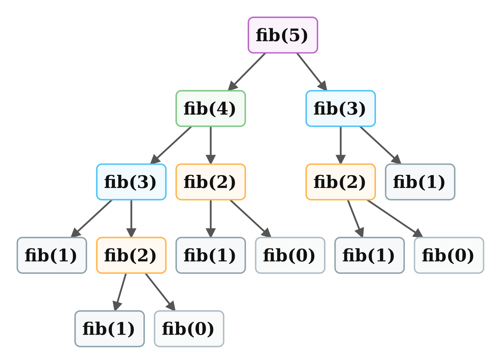
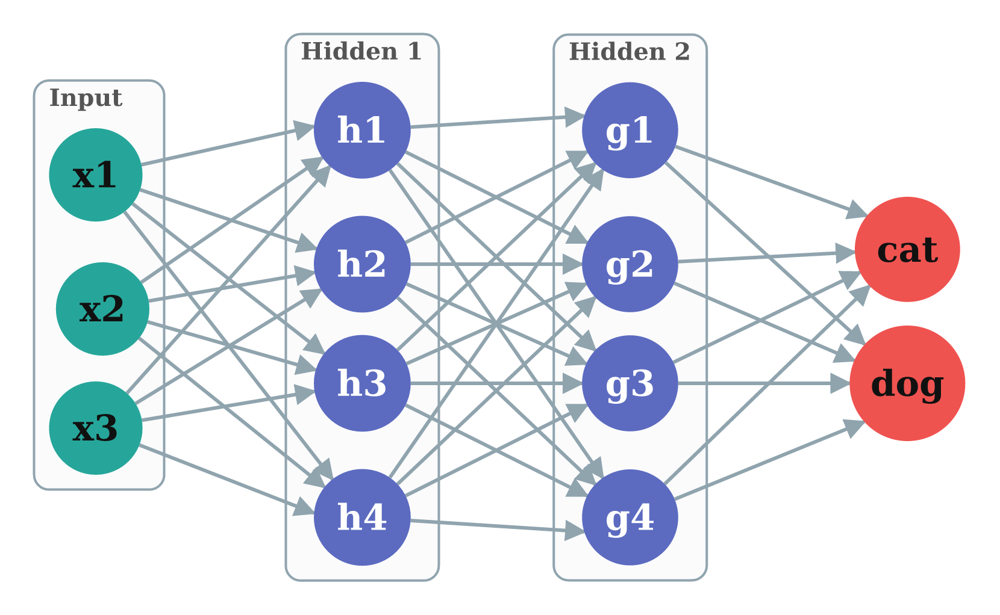

# Examples

Each image is the PNG output of the file above it, built with no flags.

## [`group_theory.fitd`](../examples/group_theory.fitd)

Group theory notes with no settings at all: a large radial map on the defaults, with bodies, math markup, and cross links.


## [`french_history.fitd`](../examples/french_history.fitd)

Real course notes: a layered timeline (down) on a portrait page, colored `group` frames per period, styles, a colored link, `require ... at` and `prefer ... at`.


## [`earth_science.fitd`](../examples/earth_science.fitd)

Radial map: `root=`, theme overrides (`root=`, `link=`), styles on nodes and edges, a node `fill`, labeled links, `require` and `prefer`.


## [`pipeline.fitd`](../examples/pipeline.fitd)

The README example, short enough to show whole: `theme dark` with a `link=` color, three styles (one with `shape=circle`), bodies, a colored `group`, a labeled `..>` link, `left-of ... gap=`, `align row`, and a weighted `prefer ... at`.



## [`compiler.fitd`](../examples/compiler.fitd)

Layered flowchart (down): `theme dark`, `page ... margin=`, `shape=circle` terminals, two groups, a row alignment, `gap=`, `near ... within=`.



## [`cell_biology.fitd`](../examples/cell_biology.fitd)

Layered flowchart (right) that wraps into two bands: a group frame, circle molecules, a solid `fill` (text turns white), labeled arrows, an edge `color=`.


## [`coffee.fitd`](../examples/coffee.fitd)

Radial map with no `layout` or `root`: fitd picks the center. A `palette=` colors the branches, undirected `--` edges and `..` links, a `group` frames one branch's leaves, `shape=box` and a dark `fill` with `text=`, and three `prefer`s (`at`, `left-of`, `align row`), which keep a radial search cheap where `require` would not.



## [`release_pipeline.fitd`](../examples/release_pipeline.fitd)

Layered flow (right) that wraps into `bands=2`, the second band running back to the left. Styles come from [`shared/build_styles.fitd`](../examples/shared/build_styles.fitd) through `include`; a `WxH` page with `margin=`; every theme color overridden (`background`, `text`, `edge`, `link`, `label`); `align column`; a chained `require prod left-of canary left-of stage`; a mixed `prefer` chain (`above ... near ... within=`).



## [`debugging.fitd`](../examples/debugging.fitd)

Decision flow in `theme mono` for print: one fixed `font 11pt`, `bands=1`, `a4 portrait`, `\n` line breaks in titles, labeled branches, and `right-of ... gap=`, `align top`, `below`.



## [`deepseek_v4_1_flash.fitd`](../examples/deepseek_v4_1_flash.fitd)

Model architecture: DeepSeek-V4.1-Flash (September 2026), drawn only from its [model card](https://huggingface.co/deepseek-ai/DeepSeek-V4.1-Flash) and [paper](https://arxiv.org/abs/2609.19969). Image and text inputs, the causal encoder-decoder in an untitled `group`, and the serving path through DSpark. Memory parts (KV cache, SWA Bounded Replay, Engram, mHC) hang beside the layers they serve through undirected `--` edges, with `..` links to the rest. Training sits apart.



## [`semester.fitd`](../examples/semester.fitd)

A 14-week course plan from one `for w, topic in ...` loop over a list of topics. `if` / `else if` styles the exams, the break, and every fourth week as a project deadline, and `if w > 1` links each week to the one before. By hand that is 14 `node` lines, their bodies, and 13 edges; here it is one loop.



## [`services.fitd`](../examples/services.fitd)

A backend whose services all share one shape: a `def service(id, label, store)` template in [`shared/service.fitd`](../examples/shared/service.fitd), reached through `include`, draws each service, its store, the edge between them, and a `require ... above`. Five `use` lines replace twenty statements, and a `for s in users, cart, ...` loop wires the gateway.



## [`fib_calls.fitd`](../examples/fib_calls.fitd)

The call tree of naive `fib(5)`, written the way the function itself is: a recursive `def` with an `if` for the base case. Each node takes the style `.n${n}`, so the repeated subproblems share a color. Change `use fib("f", 5)` to 6 and the tree grows to 25 calls with no other edit.



## [`neural_net.fitd`](../examples/neural_net.fitd)

A 3-4-4-2 perceptron. Two `for` loops and `${names("h", 1, 4)}` write all 32 dense connections, the groups, and the column alignments. Every pair of dense layers crosses, so the build reports W0206 crossing warnings by design.



## Feature index

| Feature | Examples |
| --- | --- |
| `layout radial`, center chosen by fitd | coffee |
| `layout radial root=` | earth_science |
| `root` statement | group_theory |
| `layout layered dir=down` | pipeline, compiler, french_history, debugging, deepseek_v4_1_flash, services, fib_calls |
| `layout layered dir=right` | cell_biology, release_pipeline, semester, neural_net |
| `bands=N` | release_pipeline, debugging |
| `page` paper name | most |
| `page ... portrait` / `landscape` | french_history, debugging, deepseek_v4_1_flash / coffee |
| `page WxH` | release_pipeline |
| `page ... margin=` | compiler, release_pipeline, debugging |
| `font LO..HI wrap=` | all but group_theory and debugging |
| `font SIZE` (fixed) | debugging |
| `theme dark` | pipeline, compiler |
| `theme mono` | debugging |
| theme color overrides | earth_science, compiler, release_pipeline |
| `theme palette=` | coffee |
| `include` | release_pipeline, services |
| `style` on nodes | all but group_theory |
| `fill=` | cell_biology, earth_science, coffee, debugging, release_pipeline |
| `text=` | coffee, release_pipeline |
| `shape=circle` | cell_biology, compiler, release_pipeline, debugging, deepseek_v4_1_flash |
| `shape=box` | coffee, release_pipeline, debugging |
| `\n` in titles | group_theory, debugging |
| `->` and `..>` | all |
| undirected `--` and `..` | coffee, release_pipeline, deepseek_v4_1_flash |
| edge labels | all |
| edge `color=` | cell_biology, french_history, coffee, release_pipeline |
| edge `.style` | compiler, earth_science |
| `group` in layered layout | cell_biology, compiler, french_history, release_pipeline, deepseek_v4_1_flash |
| untitled `group` | deepseek_v4_1_flash |
| `group` in radial layout | coffee |
| `left-of` / `right-of` | compiler, coffee, release_pipeline / debugging, release_pipeline |
| `above` / `below` | release_pipeline / cell_biology, debugging |
| `gap=` | compiler, debugging |
| chained relation | release_pipeline |
| mixed chain with `near ... within=` | release_pipeline |
| `near ... within=` | compiler, cell_biology, earth_science |
| `align row` | compiler, coffee |
| `align column` | release_pipeline |
| `align top` | debugging |
| `at` places | cell_biology, earth_science, french_history, coffee, release_pipeline |
| `prefer ... weight=` | compiler, cell_biology, earth_science, coffee, release_pipeline |
| `for` over a range | neural_net |
| `for` over a list, with an index | semester, services |
| `if` / `else if` / `else` | semester, fib_calls |
| `def` and `use` templates | services, fib_calls |
| recursive template | fib_calls |
| `${expr}` in names, titles, styles, bodies | all four above |
| `names(...)` | neural_net |

## Rebuilding

After a change to layout or drawing, rebuild every image (fish):

```fish
for f in examples/*.fitd; ./target/release/fitd $f -o docs/examples/(basename $f .fitd).png; end
```
