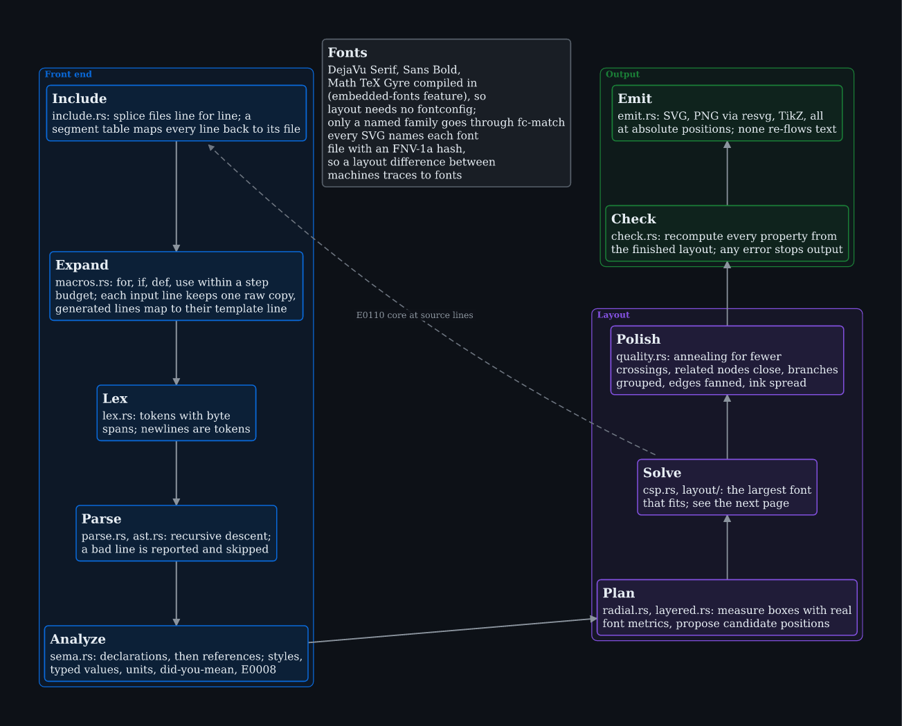
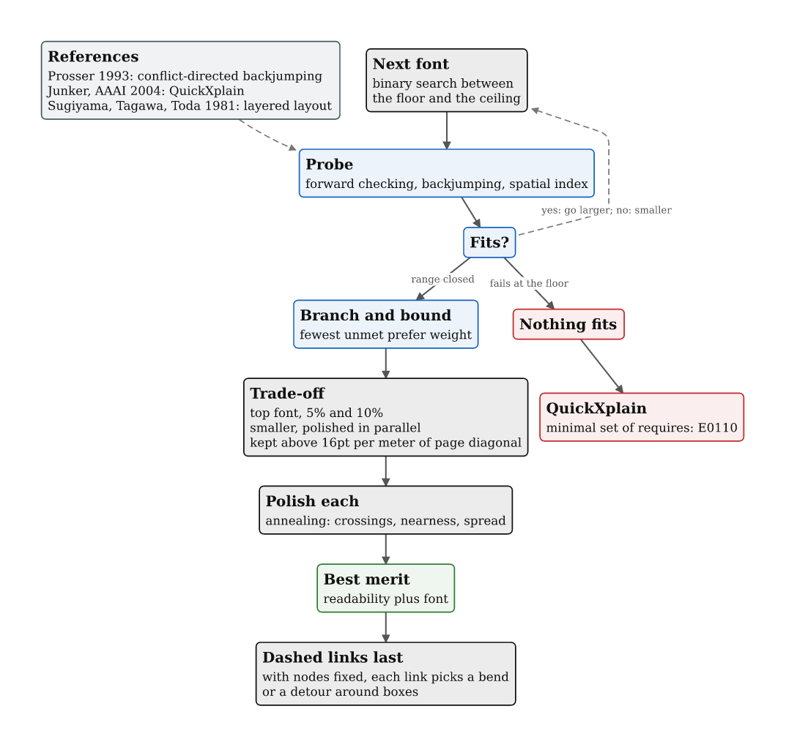
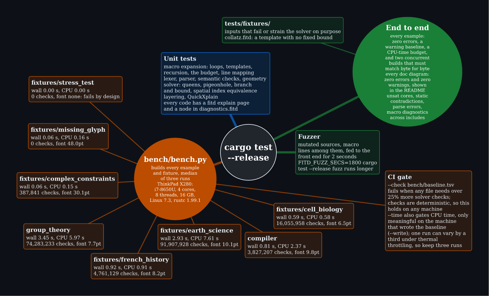

# Internals

The compiler is split into front end, layout, checking, and output code under `src/`.

## Pipeline

The pipeline is: include files, expand macros, lex, parse, analyze, plan, solve, polish, check, and emit. Diagnostics keep their original file and line through includes and macro expansion. The checker recomputes the final layout before any output is written.

Source: [01-pipeline.fitd](internals/01-pipeline.fitd)

## Solver

The solver searches font sizes and tests the hard constraints at each size. Branch and bound minimizes unmet `prefer` weights. Several candidate layouts are polished and scored for readability. If no layout fits, QuickXplain reports a minimal conflicting set of `require` statements as E0110.

References: Prosser 1993 (conflict-directed backjumping), Junker, AAAI 2004 (QuickXplain), Sugiyama, Tagawa, Toda 1981 (layered layout).

Source: [02-solver.fitd](internals/02-solver.fitd)

## Tests and benchmarks

`cargo test --release` runs unit tests, end-to-end tests for examples and fixtures, a short fuzzer, and checks that committed images still match fresh builds. Set `FITD_FUZZ_SECS` to extend the fuzz run. `python3 bench/bench.py --check bench/baseline.tsv` detects solver regressions using deterministic check counts.

Source: [03-tests.fitd](internals/03-tests.fitd)
