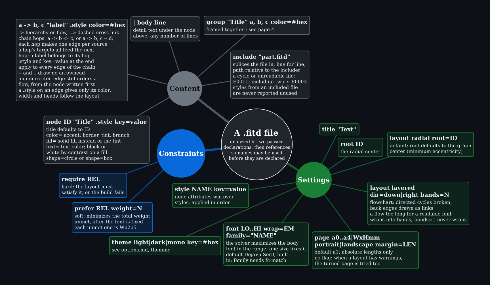
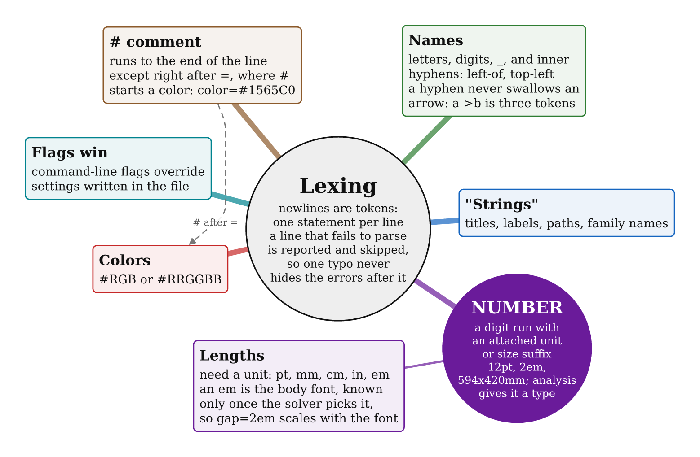
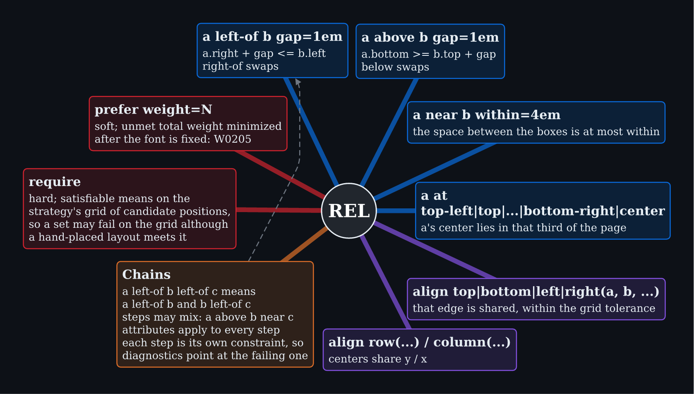
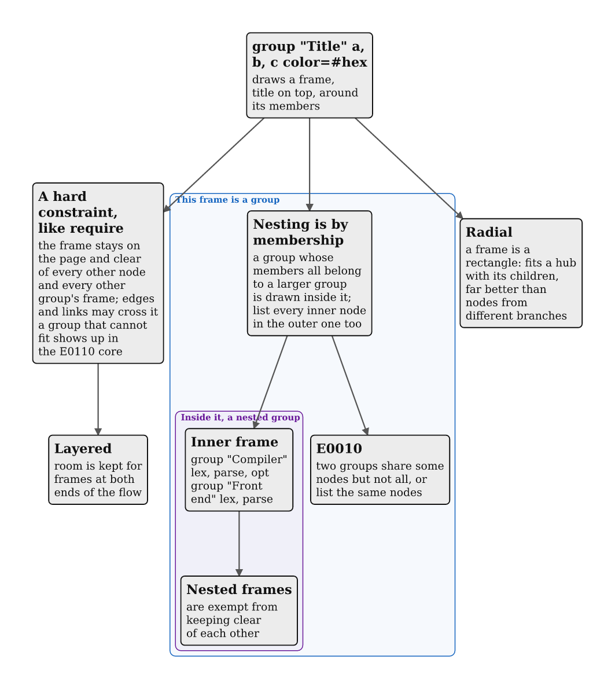
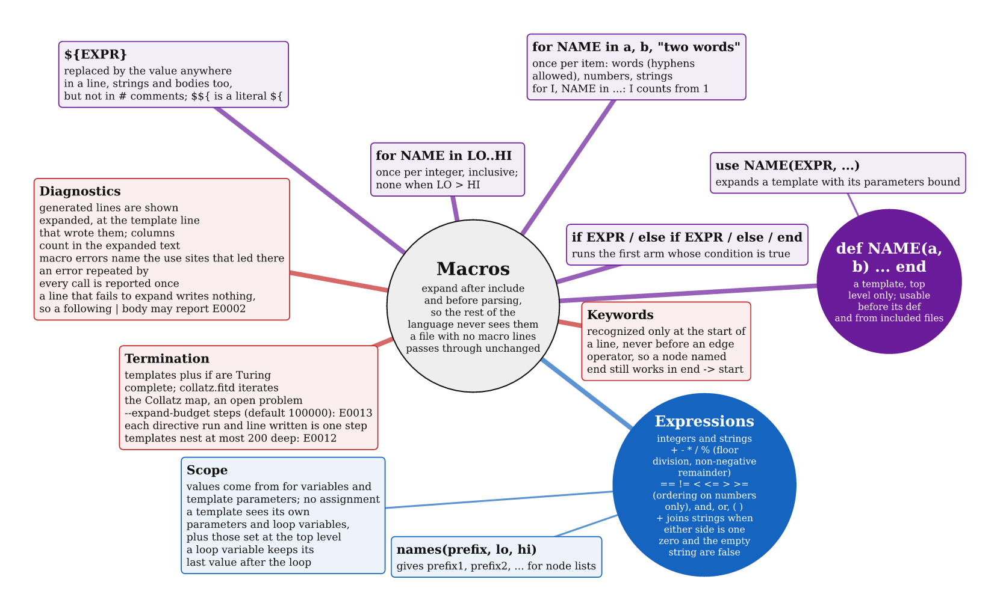
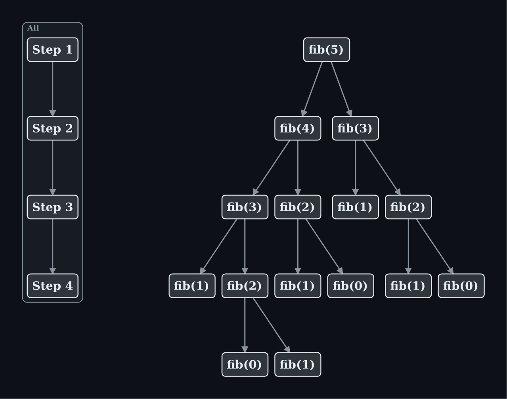
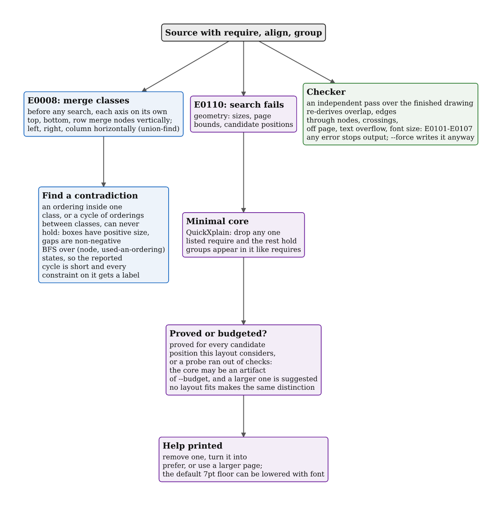
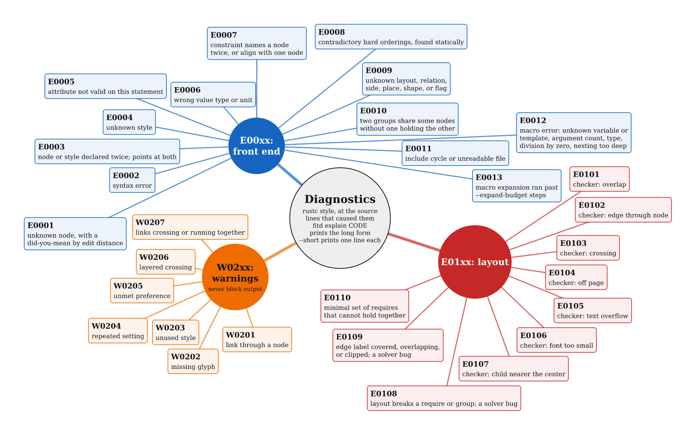

# Language

A `.fitd` file is plain text, one statement per line. Only `node` lines and edges are required; everything else has a default. `fitd guide` prints this page's summary as text.

```
title "Photosynthesis"
node sun "Light" .in
| photons absorbed by chlorophyll
node leaf "Leaf"
node sugar "Glucose"
style in color=#F9A825
leaf -> sun, sugar
sun ..> sugar "drives"
```

| Statement | Meaning |
| --- | --- |
| `node ID "Title" .style` | A box. Lines starting with `\|` add body text. |
| `a -> b, c "label" -> d` | Flow edge; `--` is undirected. Hops chain. |
| `a ..> b` | Dashed cross link; `..` is undirected. |
| `layout radial root=ID` / `layout layered dir=down\|right` | Concept map or flowchart. |
| `page`, `font`, `theme`, `style` | Page size, font range, colors, shared attributes. |
| `group "Title" a, b, c` | A frame around nodes; nests by membership. |
| `require REL` / `prefer REL weight=N` | Hard and soft layout constraints. |
| `include "part.fitd"` | Splice another file. |
| `for`, `if`, `def`, `use`, `${expr}` | Macros, expanded before parsing. |

## Statements



Source: [01-statements.fitd](language/01-statements.fitd)

## Lexing

Newlines end statements, so a line that fails to parse is reported and skipped; later errors still show. Names are letters, digits, `_`, and inner hyphens (`top-left`). A `#` starts a comment, except right after `=`, where it starts a color (`color=#0969DA`). Lengths always carry a unit (`pt mm cm in em`); an `em` is the body font, chosen by the solver, so `gap=2em` scales with it. Command-line flags override settings in the file.



Source: [02-lexical.fitd](language/02-lexical.fitd)

## Relations

Relations apply to the final box positions. Examples include `a left-of b gap=2em`, `a above b`, `a near b within=4em`, `a at top-left`, and `align row(a, b)`. Put a relation under `require` when it must hold; use `prefer` for a weighted suggestion. An unmet preference produces W0205. A chain such as `a left-of b left-of c` becomes one constraint per link.



Source: [03-relations.fitd](language/03-relations.fitd)

## Groups

A group draws a frame around its members. The frame acts as a hard constraint: it stays on the page and clear of other nodes and frames. Nesting is by membership, so list every inner node in the outer group too. Two groups that overlap without one containing the other raise E0010.



Source: [04-groups.fitd](language/04-groups.fitd)

## Macros

Macros expand after `include` and before parsing. `for i in 1..4` repeats a block. `if`/`else if`/`else` selects a block. `def NAME(args)` ... `end` defines a template, and `use NAME(args)` expands it. `${expr}` interpolates values except inside comments. `--expand-budget` stops runaway expansion and reports E0013.



Source: [05-macros.fitd](language/05-macros.fitd)

### A macro example

The left side is source. It builds four numbered steps in a loop and a recursive Fibonacci call tree from one template.

```
for i in 1..4
  node s${i} "Step ${i}"
  if i < 4
    s${i} -> s${i + 1}
  end
end
group "All" ${names("s", 1, 4)}

def fib(id, k)
  node ${id} "fib(${k})"
  if k >= 2
    use fib(id + "a", k - 1)
    use fib(id + "b", k - 2)
    ${id} -> ${id}a, ${id}b
  end
end
use fib("f", 5)
```



Source: [06-macro_example.fitd](language/06-macro_example.fitd)

## How layouts are refused

Three stages can refuse a layout: a static contradiction check (E0008, cycles of orderings found before any search), the search itself (E0110, with a minimal conflicting set from QuickXplain), and the independent checker (E0101 to E0107) that re-derives overlaps, crossings, and clipping from the finished drawing. If a search ran out of budget instead of proving the conflict, the message says so.



Source: [07-checks.fitd](language/07-checks.fitd)

## Diagnostics

Codes come in three bands: `E00xx` front end, `E01xx` layout, `W02xx` warnings that never block output. `fitd explain CODE` prints the long form of any code.



Source: [08-diagnostics.fitd](language/08-diagnostics.fitd)
