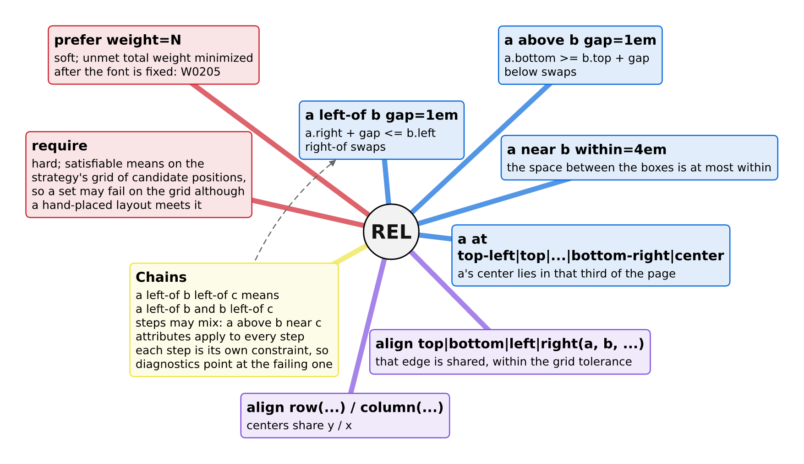

# fitd language reference

This document specifies `.fitd` syntax and semantics. For command-line options, see [Options](options.md). For implementation details, see [Internals](internals.md).

## Scope

A `.fitd` source file contains newline-delimited statements and preprocessing directives. Includes are expanded before macros; macro directives are expanded before parsing. The grammar below specifies source-level statements, including `include`. Macro syntax is described separately.

Semantic analysis validates names, attribute types, units, layout-specific options, and constraints. A syntactically valid statement can still produce a semantic diagnostic.

## Notation

Grammar uses Extended Backus-Naur Form (EBNF). Terminals appear in double quotes. `|` denotes alternation, parentheses group expressions, `[ ... ]` denotes an optional expression, and `{ ... }` denotes zero or more repetitions. A semicolon separates grammar productions. Lowercase production names denote lexical elements; capitalized names denote syntactic productions. `? ... ?` denotes an implementation-defined lexical condition described in prose.

## Source representation

A newline terminates a statement. End-of-file terminates final statement, if present. Blank lines and lines containing only comments are ignored. Statements do not continue across physical lines.

A `#` character begins a comment unless it immediately follows `=`; in that position it begins a color token. A line whose first non-whitespace character is `|` is a body line, and a line whose first non-whitespace character is `~` is a figure row; `#` has no comment meaning within either. Body lines and figure rows are associated with most recently declared node.

Includes are expanded before macro processing. Included paths are resolved relative to including file. Diagnostics retain source locations through both preprocessing stages where available. A parser error is recovered at next line, allowing subsequent statements to be checked.

## Grammar

```ebnf
Source          = { Newline | Statement, Newline } ;

Statement       = Title | Root | Layout | Page | Font | Theme | Style
                | Node | Body | Cells | Edge | Group | Key | Constraint | Include ;

Title           = "title", String ;
Root            = "root", Name ;
Layout          = "layout", Name, { Attribute } ;
Page            = "page", Value, { Name }, { Attribute } ;
Font            = "font", Value, { Attribute } ;
Theme           = "theme", [ Name ], { Attribute } ;
Style           = "style", Name, { Attribute } ;
Node            = "node", Name, [ String ], { Class | Attribute } ;
Body            = BodyLine ;
Cells           = CellRow ;
Group           = "group", [ String ], NameList, { Class | Attribute } ;
Key             = "key", String, { Class | Attribute } ;
Include         = "include", String ;

Edge            = Name, EdgeHop, { EdgeHop }, { Class | Attribute } ;
EdgeHop         = EdgeOperator, TargetList, [ String ] ;
EdgeOperator    = "->" | "--" | "..>" | ".." ;
TargetList      = Name, { [ "," ], Name } ;
NameList        = Name, { [ "," ], Name } ;

Constraint      = ( "require" | "prefer" ), Relation, { Attribute } ;
Relation        = RelationChain | Alignment | Position ;
RelationChain   = Name, Name, Name, { Name, Name } ;
Alignment       = "align", Name, "(", NameList, ")" ;
Position        = Name, "at", Name ;

Class           = ".", Name ;
Attribute       = Name, "=", Value ;
Value           = Atom, [ "..", Atom ] ;
Atom            = Name | Number | Color | String ;
Name            = Identifier ;

Identifier      = IdentifierCharacter, { IdentifierCharacter
                | "-", IdentifierCharacter } ;
Number          = AsciiDigit, { AsciiLetter | AsciiDigit
                | ".", AsciiDigit } ;
Color           = "#", HexDigit, { HexDigit } ;
String          = '"', { StringCharacter | Escape }, '"' ;
Escape          = "\\", ? any non-newline character ? ;
BodyLine        = ? "|" at first non-whitespace position, then line contents ? ;
CellRow         = ? "~" at first non-whitespace position, then cell tokens ? ;
Newline         = ? line ending or end-of-file ? ;

IdentifierCharacter = ? Unicode alphanumeric character or "_" ? ;
StringCharacter = ? any character except quote, backslash, or newline ? ;
AsciiLetter     = "A" … "Z" | "a" … "z" ;
AsciiDigit      = "0" … "9" ;
HexDigit        = AsciiDigit | "A" … "F" | "a" … "f" ;
```

`RelationChain` uses names for both node identifiers and relation operators. Valid operators are `left-of`, `right-of`, `above`, `below`, and `near`. Each operator relates adjacent nodes; for example, `a above b left-of c` specifies two relations. `Position` uses `at` followed by a supported position name.

The lexer recognizes numeric tokens permissively; semantic analysis determines valid numeric forms and units in context. Supported length units are `pt`, `mm`, `cm`, `in`, and `em`. A color must be written immediately after `=`, for example `color=#1565C0`; semantic validation accepts `#RGB` and `#RRGGBB` color values. Range values use `..` between two atoms.

## Lexical elements

Identifiers contain Unicode alphanumeric characters and underscores, with internal hyphens allowed when followed by an alphanumeric character or underscore. Identifiers are case-sensitive. ASCII digit-leading tokens are lexed as numbers rather than identifiers.

Strings use double quotes. A backslash escapes the following non-newline character; `\n` is converted to a newline character. An unterminated string is an error. Comments begin with `#` except for color tokens immediately following `=`. Comments continue to end of line.

Whitespace separates tokens. Spaces and tabs may appear between tokens. Whitespace inside a quoted string or body line is retained subject to trailing whitespace removal from body content.

## Statements

### Node declarations and body lines

`node ID ["title"]` declares a node. When title is omitted, identifier is used as title. Classes and attributes may follow declaration in any order. A class reference begins with `.` and names a previously declared style.

A body line begins with `|` in first non-whitespace position. It appends text to most recently declared node. Multiple body lines may follow one declaration. A body line without preceding node is invalid.

```fitd
node leaf "Leaf" .plant shape=box color=#2E7D32
| converts light into stored energy
```

### Figure rows

A figure row begins with `~` in first non-whitespace position. It appends one row of cells to most recently declared node. Consecutive rows form a grid drawn below the node's text, centered, using the node's accent color. A figure row without preceding node, or with no cells, is invalid.

Cells are whitespace-separated. Each cell is `[SHADE][LABEL][*SPAN]`:

| Cell | Meaning |
| --- | --- |
| `#` | Solid cell |
| `%NN` | Cell shaded at NN percent of the accent color (`%0`..`%100`) |
| `.` | Outlined cell |
| `_` | Gap: column advances, nothing is drawn |
| `NAME` or `"two words"` | Outlined cell carrying that label |
| `#NAME` or `%60"two words"` | Shaded cell carrying that label |
| `#NAME*3` | Cell spanning three columns |

A `*N` suffix is recognized only when digits end the cell, so a label such as `a*t` is kept intact. Labels on shaded cells are drawn in the page background color once shading reaches 55 percent, and in the text color below it.

Column width is the widest single-column cell in that column; a spanning cell that still does not fit widens the last column it covers. Row height is uniform. Rows need not have equal length. One primitive therefore covers sequence strips, attention masks and other heatmaps, tensor-shape bars, and unit-cell bar charts.

```fitd
node mask "Causal mask"
~ # . . .
~ # # . .
~ # # # .
~ # # # #

node bar "Attention weights"
~ %90 %55 %20 %5
~ #"d_model = 64"*4
```

### Stacked nodes

`stack=N` draws a node as N identical copies, offset up and to the right, with the frontmost copy carrying the text and figure. N ranges from 1 to 8. This is the conventional way to show a block repeated N times, such as N identical encoder layers.

```fitd
node enc "Encoder layer" stack=4
~ #"d 64"*4
```

### Per-node wrap and aside placement

`wrap=24em` overrides the page-wide `font wrap=` for one node, so a long note can be wider than the boxes in the flow. The value must be in `em`.

`place=aside` moves a node out of a layered flow into a strip after it (below the flow for `dir=right`, to the right for `dir=down`). The node keeps its `..>` links and sits as close as it can to the nodes it links to. It is meant for notes, training stages, and similar annotations. A `->` between two aside nodes orders the strip without joining the flow; a node on a `->` edge to a flow node, or in a group, stays in the flow and gets W0208. `place=flow` is the default.

```fitd
layout layered dir=right
node a "Input"
node enc "Encoder"
node out "Output"
a -> enc -> out
node pre "Pretraining" wrap=34em place=aside
pre ..> enc "init"
```

### Edges

An edge statement begins with source node identifier and contains one or more hops. Each hop contains operator, target list, and optional quoted label. All hops in one statement may be followed by shared classes and attributes.

| Operator | Direction | Link type |
| --- | --- | --- |
| `->` | Directed | Flow edge |
| `--` | Undirected | Flow edge |
| `..>` | Directed | Cross-link |
| `..` | Undirected | Cross-link |

Each target in a hop becomes a source for next hop. Thus `a -> b, c -> d` creates edges from `a` to `b` and `c`, then from both `b` and `c` to `d`.

```fitd
a -> b, c "produces" -- d .important color=#1565C0
```

### Groups

`group ["title"] members` declares a frame containing listed nodes. Membership is specified by node identifiers. To nest groups, list inner group members in outer group as well. Group frames must fit page and avoid overlapping nodes and non-nested groups. Non-nested overlapping groups produce E0010. A `.class` after the members sets the frame color from that style, so a group, its nodes, and its `key` entry can share one style.

`times=N` (2 to 99) marks the framed subgraph as repeated N times: the frame is drawn dashed and `Nx` is prefixed to its title, which is the conventional notation for a repeated stack of layers. A value outside the range, or a non-numeric one, produces E0006.

```fitd
group "Layers" attn, ff times=2 color=#3949AB
```

### Keys

`key "LABEL" [.class] [attributes]` adds one legend entry. Entries are drawn in centered rows along the bottom of the page, wrapping when a row is full; the solver lays out the diagram in the space above. Swatches take `color`, `fill`, and `shape` from classes and attributes, as nodes do. `line=solid` or `line=dashed` draws a line swatch for edge colors instead of a node swatch. `page ... keysize=20pt` sets the swatch and text size (default 0.85 of the chosen body font); line thickness scales with it. In split output, keys repeat on every page.

```fitd
key "Investment" line=solid color=#4FC3E0
key "Principal" shape=circle fill=#FFFFFF color=#222222
```

### Layout selection

`layout NAME` selects layout algorithm and accepts layout-specific attributes. Supported algorithms include `radial` and `layered`. Radial layouts use `root=ID`; layered layouts accept `dir=down` or `dir=right`.

### Page and font settings

`page SIZE [FLAGS] [attributes]` selects page dimensions and orientation. Named paper sizes range from `a0` through `a4`; explicit dimensions use `WIDTHxHEIGHT` followed by unit. Supported page flags include `portrait` and `landscape`. Example:

```fitd
page a4 portrait margin=12mm
page 297x210mm margin=1cm
```

`font VALUE [attributes]` sets font size or font-size search range. A fixed size or range can be specified. Length units are `pt`, `mm`, `cm`, `in`, and `em`; `em` is relative to body font size. `wrap` sets text width, and `family` selects font family. For example, `font 7pt..48pt wrap=24em family="DejaVu Sans"` sets search bounds, wrapping width, and font family.

`title "TEXT"` sets document title. `root ID` sets root node for layouts that require one. Command-line options override corresponding source settings.

### Themes and styles

`theme [PRESET] [attributes]` selects theme and applies overrides. Presets are `dark`, `light`, and `mono`; default preset is `dark`. `style NAME attributes` declares reusable node or edge attributes. A declaration may use multiple classes; class attributes are applied in order.

On nodes, edges, and groups, `color`, `fill`, and `text` specify border, fill, and text colors where supported. `shape` accepts `box`, `circle`, or `none` for nodes and styles, and `stack` accepts 1 to 8 copies for nodes and styles. `shape=none` draws the text and figure with no frame or fill, for margin annotations and lane labels; such a node still participates in layout, edges, and constraints. Attribute support depends on statement kind; unknown or ill-typed attributes produce diagnostics.

`gradient=COLOR` on `theme` paints the page with a diagonal gradient from `background` to `COLOR`. `background` remains the solid color used behind labels.

```fitd
theme light background=#FFFFFF text=#24292F
style plant shape=box color=#2E7D32
node leaf "Leaf" .plant
```

### Constraints



`require RELATION` declares hard constraint. A failed hard constraint prevents normal output. Static contradictions may be reported before search; unsatisfiable constraint sets produce E0110 and a minimal conflicting set when established.

`prefer RELATION [attributes]` declares soft constraint. `weight=N` sets relative preference weight. An unmet preference produces W0205 and does not by itself block output.

Binary relations are `left-of`, `right-of`, `above`, `below`, and `near`. `near` accepts optional `within=LENGTH`; ordering relations accept optional `gap=LENGTH`. `at` positions node at one of nine positions: `top-left`, `top`, `top-right`, `left`, `center`, `right`, `bottom-left`, `bottom`, and `bottom-right`. `align SIDE(nodes)` aligns nodes by `top`, `bottom`, `left`, `right`, `row`, or `column`.

```fitd
require source left-of parser gap=2em
require align row(parser, solver, checker)
prefer output at right weight=2
```

### Includes

`include "PATH"` inserts source file before macro expansion and parsing. Path is resolved relative to including file. Include cycles and missing files produce diagnostics.

A path beginning with `std/` names a module of the bundled library instead of a file on disk, so it resolves the same way from any directory. `fitd std` lists the modules and `fitd std NAME` prints one.

| Module | Contents |
| --- | --- |
| `std/nn.fitd` | Neural-network blocks: `nn_input`, `nn_layer`, `nn_step`, `nn_out`, `nn_mask`, `nn_mask_rows`, `nn_mask_pad_rows`, `nn_note`, `nn_add`, plus the `nn_*` styles |
| `std/flow.fitd` | Flowchart role styles (`io`, `step`, `decide`, `done`, `drop`) and `flow_key()` |
| `std/palette.fitd` | Okabe-Ito color-blind-safe classes `c1`..`c8` |

```fitd
include "std/nn.fitd"
use nn_input("x", "Tokens", "B x L")
use nn_layer("e", "Encoder", "d 64", 2)
use nn_mask("m", "Causal mask", 4, 1)
x -> e -> m
```

### Macros


Macro processing provides `for`, `if`/`else if`/`else`, `def`/`use`, and `${expression}` interpolation. Directives use indentation for readability; block boundaries are marked by `end`. Macro expressions support integer and string values, arithmetic, comparisons, boolean operators, function calls, and ranges. `${expression}` substitutes expression result into generated source, except inside comments. Expansion is bounded by `--expand-budget`; exceeding limit produces E0013.

```fitd
for i in 1..3
  node step${i} "Step ${i}"
end
```

## Semantic validation and diagnostics


Node identifiers must be declared with `node` before being referenced by edges, groups, or constraints. Node and style declarations must be unique. Styles must exist when referenced. Layouts, relation operators, positions, attributes, and attribute values are validated according to statement context.

Diagnostic codes use three ranges: E00xx for front-end errors, E01xx for layout errors, and W02xx for warnings. Warnings do not block output. `fitd explain CODE` prints detailed explanation for a diagnostic code. Source locations are retained through includes and macro expansion where possible.
