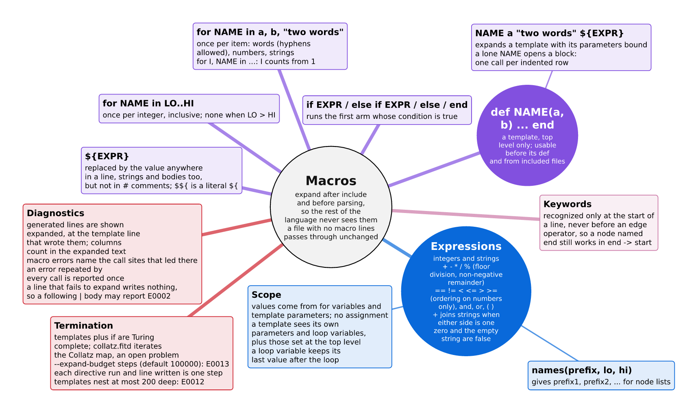
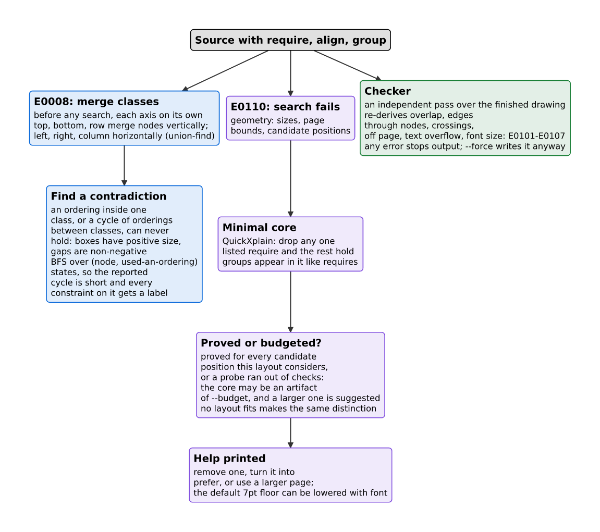
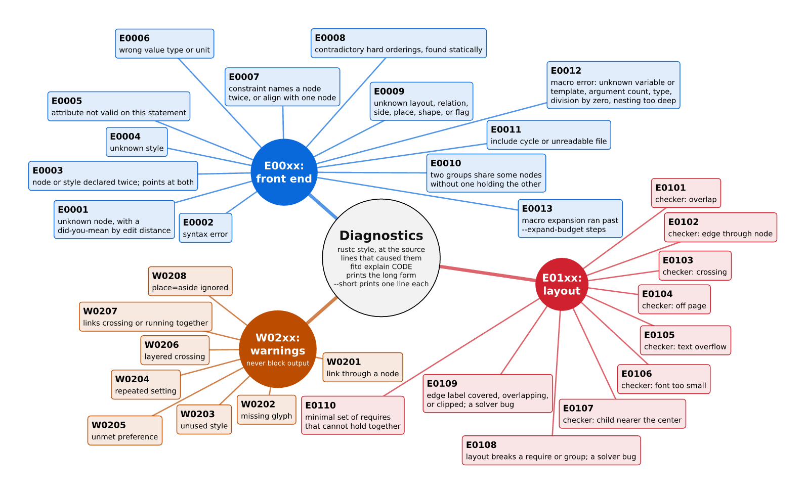

# fitd language reference

This document specifies `.fitd` syntax and semantics. For command-line options, see [Options](options.md). For implementation details, see [Internals](internals.md).

## Scope

A `.fitd` source file contains newline-delimited statements and preprocessing directives. Includes are expanded before macros; macro directives are expanded before parsing. The grammar below specifies source-level statements, including `include`. Macro syntax is described separately.

Semantic analysis validates names, attribute types, units, layout-specific options, and constraints. A syntactically valid statement can still produce a semantic diagnostic.

## Notation

Grammar uses Extended Backus-Naur Form (EBNF). Terminals appear in double quotes. `|` denotes alternation, parentheses group expressions, `[ ... ]` denotes an optional expression, and `{ ... }` denotes zero or more repetitions. A semicolon separates grammar productions. Lowercase production names denote lexical elements; capitalized names denote syntactic productions. `? ... ?` denotes an implementation-defined lexical condition described in prose.

## Source representation

A newline terminates a statement. End-of-file terminates final statement, if present. Blank lines and lines containing only comments are ignored. A statement continues onto the next line only inside `[...]` or `(...)`, so a long attribute list may wrap.

`//` begins a comment that runs to the end of the line. `#` only begins a color token, written immediately after `=`. A line whose first non-whitespace character is `|` is a body line, and a line whose first non-whitespace character is `~` is a figure row; `//` has no comment meaning within either. Body lines and figure rows belong to the node whose braces hold them.

Includes are expanded before macro processing. Included paths are resolved relative to including file. Diagnostics retain source locations through both preprocessing stages where available. A parser error is recovered at the next line or `}`, allowing subsequent statements to be checked. Indentation carries no meaning; `fitd fmt` indents each block by two spaces.

## Grammar

```ebnf
Source          = { Newline | Statement, Newline | "}", Newline } ;

Statement       = Title | Root | Layout | Page | Font | Theme | Style
                | Node | Body | Cells | Edge | Group | Key | Constraint | Include
                | With | Call ;

Title           = "title", String ;
Root            = "root", Name ;
Layout          = "layout", Name, [ Attributes ] ;
Page            = "page", Value, { Name }, [ Attributes ] ;
Font            = "font", Value, [ Attributes ] ;
Theme           = "theme", [ Name ], [ Attributes ] ;
Style           = "style", QualName, [ Attributes ] ;
With            = "with", QualName, [ "{" ] ;
Node            = Name, [ String ], [ Attributes ], [ "{" ] ;
Call            = QualName, "(", [ Arg, { ",", Arg } ], ")", [ "{" ] ;
Arg             = [ Name, "=" ], ( Name | Number | String | ArgList | "${", Expr, "}" ) ;
ArgList         = "[", [ Arg, { ",", Arg } ], "]" ;
Body            = BodyLine ;
Cells           = "~", ( CellList | "image", String, [ Attributes ] ) ;
CellList        = "[", Cell, { ",", Cell }, "]" ;
Group           = "group", [ [ Name ], String ], NameList, [ Attributes ] ;
Key             = "key", String, [ Attributes ] ;
Include         = "include", String ;

Edge            = [ NameList ], EdgeHop, { EdgeHop }, [ Attributes ] ;
EdgeHop         = EdgeOperator, TargetList, [ String ] ;
EdgeOperator    = "->" | "--" | "..>" | ".." ;
TargetList      = Name, { [ "," ], Name } ;
NameList        = Name, { [ "," ], Name } ;

Constraint      = ( "require" | "prefer" ), Relation, [ Attributes ] ;
Relation        = RelationChain | Alignment | Position ;
RelationChain   = Name, Name, Name, { Name, Name } ;
Alignment       = "align", Name, "(", NameList, ")" ;
Position        = Name, "at", Name ;

Attributes      = "[", [ Attribute, { ",", Attribute } ], "]" ;
Attribute       = Name, "=", Value ;
Value           = Atom, [ "..", Atom ] ;
Atom            = Name | Number | Color | String ;
Name            = Identifier ;
QualName        = [ Identifier, "." ], Identifier ;

Identifier      = IdentifierCharacter, { IdentifierCharacter
                | "-", IdentifierCharacter } ;
Number          = AsciiDigit, { AsciiLetter | AsciiDigit
                | ".", AsciiDigit } ;
Color           = "#", HexDigit, { HexDigit } ;
String          = '"', { StringCharacter | Escape }, '"' ;
Escape          = "\\", ? any non-newline character ? ;
BodyLine        = ? "|" at first non-whitespace position, then line contents ? ;
Cell            = ? text up to "," or "]"; see Figure rows ? ;
Newline         = ? line ending or end-of-file ? ;

IdentifierCharacter = ? Unicode alphanumeric character or "_" ? ;
StringCharacter = ? any character except quote, backslash, or newline ? ;
AsciiLetter     = "A" … "Z" | "a" … "z" ;
AsciiDigit      = "0" … "9" ;
HexDigit        = AsciiDigit | "A" … "F" | "a" … "f" ;
```

A node, call, or `with` line that ends in `{` opens a block, and a line holding only `}` closes the innermost one. Statements inside a block take its scope, described under Node declarations and Style blocks. A `{` after any other statement, a `}` with no open block, and a `{` never closed are errors.

`RelationChain` uses names for both node identifiers and relation operators. Valid operators are `left-of`, `right-of`, `above`, `below`, and `near`. Each operator relates adjacent nodes; for example, `a above b left-of c` specifies two relations. `Position` uses `at` followed by a supported position name.

The lexer recognizes numeric tokens permissively; semantic analysis determines valid numeric forms and units in context. Supported length units are `pt`, `mm`, `cm`, `in`, and `em`. A color must be written immediately after `=`, for example `color=#1565C0`; semantic validation accepts `#RGB` and `#RRGGBB` color values. Range values use `..` between two atoms.

## Lexical elements

Identifiers contain Unicode alphanumeric characters and underscores, with internal hyphens allowed when followed by an alphanumeric character or underscore. Identifiers are case-sensitive. ASCII digit-leading tokens are lexed as numbers rather than identifiers.

Strings use double quotes. A backslash escapes the following non-newline character; `\n` is converted to a newline character. An unterminated string is an error. Comments begin with `//` and continue to end of line.

Whitespace separates tokens. Spaces and tabs may appear between tokens. Whitespace inside a quoted string or body line is retained subject to trailing whitespace removal from body content.

## Statements

### Node declarations and body lines

`ID ["title"] [[attributes]]` declares a node. When title is omitted, identifier is used as title. Statement and macro keywords (`page`, `font`, `group`, `for`, `def`, ...) are reserved and cannot name a node (E0002).

A node line ending in `{` opens the node's block. A node declared inside the block is its child: the parent gets an edge to it, `--` in a radial layout (the default) and `->` in the others. A line that starts with an edge operator inside a node's block is an edge from that node, so `-> b "yes"` inside `a { }` means `a -> b "yes"`. A line holding only a declared node's identifier reopens it (`a {` adds children to `a`) and, inside another node's block, also links that node to it. Body lines and figure rows inside the block describe the node. A `with` block inside a node keeps the node's scope, so a whole branch can take a style:

```fitd
style method [shape=box]
coffee "Coffee" {
  brew "Brewing" {
    | extraction: 18-22% of the dose
    with method {
      espresso "Espresso"
      -> crema "crema"
      filter "Pour-over"
    }
  }
  crema "Crema"
}
coffee {
  roast "Roasting"
}
```

Only one hierarchy can follow nesting, so cross links, groups, and lanes stay explicit.

`with STYLE {` opens a style block that ends at its `}`. Every node, edge, group, and key inside the block takes that style, so a style is written once for many lines. Module styles use qualified names: `with nn.block {`. Blocks nest, and inner styles apply after outer ones. A `with` naming an undeclared style is E0004. Because `with` marks the style, a node and a style may share a name. A block may hold `for`, `if`, and template calls, and may sit inside them.

A body line begins with `|` in first non-whitespace position. It appends text to the node whose block holds it. A node may hold many body lines. A body line outside any node block is invalid.

Spaces after the one following `|` indent the line in box and frameless nodes, as in pseudocode; wrapped continuation lines keep that indent. In any node text, `**` toggles bold, so `**if** x **then**` sets the keywords in bold.

```fitd
with plant {
  leaf "Leaf" [color=#2E7D32] {
    | converts light into stored energy
  }
  stem "Stem"
}
```

### Figure rows

A figure row begins with `~` in first non-whitespace position. It appends one row of cells to the node whose block holds it. Consecutive rows form a grid drawn below the node's text, centered, using the node's accent color. A figure row outside any node block, or with no cells, is invalid.

Cells sit in brackets, separated by commas: `~ [%100, ., GLU]`. Each cell is `[SHADE][LABEL][*SPAN]`:

| Cell                        | Meaning                                                      |
| --------------------------- | ------------------------------------------------------------ |
| `%NN`                       | Cell shaded at NN percent of the accent color (`%0`..`%100`); `%100` is solid |
| `.`                         | Outlined cell                                                |
| `_`                         | Gap: column advances, nothing is drawn                       |
| `NAME` or `"two words"`     | Outlined cell carrying that label                            |
| `%100NAME` or `%60"two words"` | Shaded cell carrying that label                              |
| `%100NAME*3`                | Cell spanning three columns                                  |

A `*N` suffix is recognized only when digits end the cell, so a label such as `a*t` is kept intact. Labels on shaded cells are drawn in the page background color once shading reaches 55 percent, and in the text color below it.

Column width is the widest single-column cell in that column; a spanning cell that still does not fit widens the last column it covers. Row height is uniform. Rows need not have equal length. One primitive therefore covers sequence strips, attention masks and other heatmaps, tensor-shape bars, and unit-cell bar charts.

```fitd
mask "Causal mask" {
  ~ [%100, ., ., .]
  ~ [%100, %100, ., .]
  ~ [%100, %100, %100, .]
  ~ [%100, %100, %100, %100]
}

bar "Attention weights" {
  ~ [%90, %55, %20, %5]
  ~ [%100"d_model = 64"*4]
}
```

An image row, `~ image "PATH" width=Nem`, puts a PNG or JPEG in the figure instead of cells. It is drawn the full figure width, centered, and its height follows the picture's pixel aspect ratio. `width=` takes an em length and defaults to `10em`, so the picture scales with the body font like everything else. The path is relative to the main file, even inside an included file; a file that cannot be read or is not a PNG or JPEG is error E0014. SVG output embeds the bytes as a data URI, PDF and PNG draw them, and TikZ writes `\includegraphics{PATH}`. This is how a plot from a plotting library goes inside a diagram.

```fitd
eval "Validation" {
  ~ image "loss.png" [width=9em]
}
```

### Stacked nodes

`stack=N` draws a node as N identical copies, offset up and to the right, with the frontmost copy carrying the text and figure. N ranges from 1 to 8. This is the conventional way to show a block repeated N times, such as N identical encoder layers.

```fitd
enc "Encoder layer" [stack=4] {
  ~ [%100"d 64"*4]
}
```

### Per-node wrap and aside placement

`wrap=24em` overrides the page-wide `font wrap=` for one node, so a long note can be wider than the boxes in the flow. The value must be in `em`.

`place=aside` moves a node out of a layered flow into a strip after it (below the flow for `dir=right`, to the right for `dir=down`). The node keeps its `..>` links and sits as close as it can to the nodes it links to. It is meant for notes, training stages, and similar annotations. A `->` between two aside nodes orders the strip without joining the flow; a node on a `->` edge to a flow node, or in a group, stays in the flow and gets W0208. With `dir=right`, a strip node's `~` figure sits beside its text to keep the strip short. `place=flow` is the default.

```fitd
layout layered [dir=right]

a "Input"
enc "Encoder"
out "Output"
a -> enc -> out
pre "Pretraining" [wrap=34em, place=aside]
pre ..> enc "init"
```

### Edges

An edge statement begins with one or more source node identifiers, separated by commas, and contains one or more hops. Each hop contains operator, target list, and optional quoted label. All hops in one statement may be followed by shared classes and attributes.

| Operator | Direction  | Link type  |
| -------- | ---------- | ---------- |
| `->`     | Directed   | Flow edge  |
| `--`     | Undirected | Flow edge  |
| `..>`    | Directed   | Cross-link |
| `..`     | Undirected | Cross-link |

Each target in a hop becomes a source for next hop. Thus `a -> b, c -> d` creates edges from `a` to `b` and `c`, then from both `b` and `c` to `d`. A source list fans in: `a, b -> c` creates `a -> c` and `b -> c`, each with the hop's label.

```fitd
with important {
  a -> b, c "produces" -- d [color=#1565C0]
}
```

Edges and edge styles take `color`, `head`, `tail`, and `line`. `head` marks the target end and `tail` the source end, each one of `arrow`, `triangle` (hollow), `diamond`, `odiamond` (hollow diamond), `crow` (crow's foot), or `none`. A directed edge defaults to `head=arrow`, an undirected one to none; `tail` defaults to none. `line=solid|dashed|dotted` sets the dash pattern; `..>` and `..` default to dashed. Marks sit inside the arrow clearance, so they never change the layout.

```fitd
style is [head=triangle]
with is {
  circle -> shape
}
canvas -- shape [tail=diamond, line=dotted]
```

### Groups

`group ["title"] members` declares a frame containing listed nodes. Membership is specified by node identifiers. To nest groups, list inner group members in outer group as well. Group frames must fit page and avoid overlapping nodes and non-nested groups. Non-nested overlapping groups produce E0010, except under `layout venn`. A group inside a `with` block takes its frame color from that style, so a group, its nodes, and its `key` entry can share one block.

`group ID "title" members` also names the group, so edges can start or end at it: the edge meets the frame instead of a member. An empty title, `group ID "" members`, gives a named group with no title. A group ID shares the node namespace, so a node and a group cannot have the same ID (E0003). For layout, the edge stands in for the group with a member: the last member of the flow when the group is the source, the first when it is the target. An edge from a group to itself, to one of its members, or to a group nested with it is E0016, as is a group edge under `layout venn` or `layout lanes`.

```fitd
layout layered

load "Load" {
  clean "Clean"
}
train "Train" {
  tune "Tune"
}
report "Report"
group prep "Prep" load, clean
group fit "Fit" train, tune
prep -> fit "data"
fit -> report
```

`times=N` (2 to 99) marks the framed subgraph as repeated N times: the frame is drawn dashed and `Nx` is prefixed to its title, which is the conventional notation for a repeated stack of layers. A value outside the range, or a non-numeric one, produces E0006.

```fitd
group "Layers" attn, ff [times=2, color=#3949AB]
```

### Keys

`key "LABEL" [attributes]` adds one legend entry. Entries are drawn in centered rows along the bottom of the page, wrapping when a row is full; the solver lays out the diagram in the space above. Swatches take `color`, `fill`, and `shape` from classes and attributes, as nodes do. `line=solid|dashed|dotted` draws a line swatch for edges instead of a node swatch, and `head=` adds a mark at its right end. A key whose classes are used only by groups draws an open frame swatch. `page ... keysize=20pt` sets the swatch and text size (default 0.85 of the chosen body font); line thickness scales with it. In split output, keys repeat on every page.

```fitd
key "Investment" [line=solid, color=#4FC3E0]
key "Principal" [shape=circle, fill=#FFFFFF, color=#222222]
```

### Layout selection

`layout NAME` selects layout algorithm and accepts layout-specific attributes. Supported algorithms are `radial`, `layered`, `lanes`, and `venn`. Radial layouts use `root=ID`; layered layouts accept `dir=down` or `dir=right`, `bands=N`, and `order=source`. By default a layered layout reorders nodes within a layer to cut edge crossings; `order=source` instead keeps roots in declaration order and children in the order of their incoming edges, which org charts, syntax trees, and fishbones need. Without `order=source`, declaration order does not matter: nodes are taken in the order edges first mention them, so moving a style block leaves the layout unchanged. A long layered flow folds into bands when one band does not fit; on a ratio page (`page 16:9`) it also tries 2 and 3 bands and keeps the count with the largest font. `bands=N` caps the count.

`layout lanes` draws swimlanes and sequence diagrams. It takes `dir` and `order` like `layered`. Each top-level group is a lane, and lanes sit side by side in declaration order with frames that span the whole flow. Nodes stack along their lane in flow order, and edges cross between lanes. A node with `lane=ID` hangs on a dashed lifeline below ID, after the earlier nodes on that lane; ID heads the lane and its lane nodes share it. An empty `shape=none` node draws as a point on the lifeline. With `order=source`, heads take the first row and each later row holds one `align row` set, in declaration order, so messages keep source order:

```fitd
layout lanes [order=source]

style pt [shape=none]
c "Client"
s "Server"
with pt {
  c1 "" [lane=c]
  s1 "" [lane=s]
}
c1 -> s1 "GET /orders"
require align row(c1, s1)
```

The `seq` module wraps this as `seq.actor`, `seq.msg`, and `seq.reply`.

`layout venn` draws a Venn diagram. It takes no attributes. Each group is a set circle, drawn in its style block's color or the next palette color with its title outside the circle. Groups may share nodes in any way, and every node sits in the region of exactly the sets that list it; a node in no group sits outside all circles. Nodes default to `shape=none`. Two sets sit side by side and three sit in a triangle, with the overlap sized for the most crowded region. A fourth set gives E0010:

```fitd
layout venn

py "Python"
both "garbage collected"
go "Go"
group "Scripting" py, both
group "Compiled" go, both
```

The `venn` module wraps this as `venn.two` and `venn.three`, which take each region's items as one `;`-separated string.

### Page and font settings

`page SIZE [FLAGS] [attributes]` selects page dimensions and orientation. Named paper sizes range from `a0` through `a4`; explicit dimensions use `WIDTHxHEIGHT` followed by unit. Supported page flags include `portrait` and `landscape`. Example:

```fitd
page a4 portrait [margin=12mm]
page 297x210mm [margin=1cm]
page 16:9 [margin=12pt]
```

A ratio `W:H` such as `16:9`, `4:3`, or `1.414:1` fixes only the page shape. fitd picks the smallest page of that shape on which the diagram fits at the font floor and meets as many checks and `prefer` constraints as it does on an unbounded page, then reports the size it chose (`note: page 16:9 fits on 845x475pt`). Since the page is as small as the floor allows, text comes out near the floor, so set `font` to the smallest size the reader should see (`font 10pt..30pt`). `portrait` and `landscape` turn the ratio; the page is never turned on its own. A `--stable` lock made for a page of the same shape keeps its size. Ratios beyond 20:1 are rejected.

`font VALUE [attributes]` sets font size or font-size search range. A fixed size or range can be specified. Length units are `pt`, `mm`, `cm`, `in`, and `em`; `em` is relative to body font size. `wrap` sets text width, and `family` selects font family. For example, `font 7pt..48pt wrap=24em family="DejaVu Sans"` sets search bounds, wrapping width, and font family. Without a `font` statement the range is `9pt..28pt`.

`title "TEXT"` sets document title. `root ID` sets root node for layouts that require one. Command-line options override corresponding source settings.

### Themes and styles

`theme [PRESET] [attributes]` selects theme and applies overrides. Presets are `paper`, `light`, `dark`, and `mono`; default preset is `paper`. `style NAME [attributes]` declares reusable node or edge attributes, applied with `with NAME { }`. Nested `with` blocks apply their styles outermost first.

On nodes, edges, and groups, `color`, `fill`, and `text` specify border, fill, and text colors where supported. `shape` accepts `box`, `circle`, `diamond`, or `none` for nodes and styles, and `stack` accepts 1 to 8 copies for nodes and styles. `shape=none` draws the text and figure with no frame or fill, for margin annotations and lane labels; such a node still participates in layout, edges, and constraints. Attribute support depends on statement kind; unknown or ill-typed attributes produce diagnostics.

`theme` overrides take colors: `background=` (page, also behind labels), `text=`, `edge=` (`->` and `--` edges), `link=` (`..>` and `..` cross-links), `label=` (edge labels), `root=` (root node fill), and `palette="#0072B2 #D55E00"` (accents cycled over nodes). `fitd docs attrs` lists every attribute on every statement.

`gradient=COLOR` on `theme` paints the page with a diagonal gradient from `background` to `COLOR`. `background` remains the solid color used behind labels.

```fitd
theme light [background=#FFFFFF, text=#24292F]

style plant [shape=box, color=#2E7D32]
with plant {
  leaf "Leaf"
}
```

### Constraints


`require RELATION` declares hard constraint. A failed hard constraint prevents normal output. Static contradictions may be reported before search; unsatisfiable constraint sets produce E0110 and a minimal conflicting set when established.

`prefer RELATION [attributes]` declares soft constraint. `weight=N` sets relative preference weight. An unmet preference produces W0205 and does not by itself block output.

Binary relations are `left-of`, `right-of`, `above`, `below`, and `near`. `near` accepts optional `within=LENGTH`; ordering relations accept optional `gap=LENGTH`. `at` positions node at one of nine positions: `top-left`, `top`, `top-right`, `left`, `center`, `right`, `bottom-left`, `bottom`, and `bottom-right`. `align SIDE(nodes)` aligns nodes by `top`, `bottom`, `left`, `right`, `row`, or `column`.

```fitd
require source left-of parser [gap=2em]
require align row(parser, solver, checker)
prefer output at right [weight=2]
```

Nodes can also be placed on a grid with `row=R col=C`, counted from 1. Nodes with the same `row` share an `align row` and sit left to right by `col`; nodes with the same `col` share an `align column` and stack top to bottom by `row`. Both are hard constraints. In a layered layout, a hard `above` (`dir=down`) or `left-of` (`dir=right`) also orders layers, so unconnected nodes can stack. Two nodes in one cell give E0007.

```fitd
layout layered

a "A" [row=1, col=1]
b "B" [row=1, col=2]
c "C" [row=2, col=1]
d "D" [row=2, col=2]
a -> b, c
b, c -> d
```

### Includes

`include "PATH"` inserts source file before macro expansion and parsing. Path is resolved relative to including file. Every `include` must come before the file's other statements, as Go requires for `import`; comments may precede it. Include cycles, missing files, and a late `include` produce E0011.

A bare name with no `/` or `.`, such as `include "nn"`, names a module of the bundled library instead of a file on disk, so it resolves the same way from any directory. `fitd std` lists the modules and `fitd std NAME` prints one. A module's templates are called by module name, as `MOD.name(ARGS)` on a line of its own. Styles are global and keep the module prefix; `with nn.layer {` applies style `nn.layer`.

`MOD.name(a, "Two words", 3, cells=[x, y])` passes its arguments by position or by `key=`; parameters left out take their defaults. A bare word is text, a run of digits is a number, quotes group text with spaces or symbols, `[a, b]` is a list, and `${expr}` passes the value itself, so `f(${n + 1})` passes a number. Dotted words such as style names are quoted: `"seq.msg"`. A call ending in `{` opens a block that lands in the last node the template declared, so nested calls build trees with no edge lines:

```fitd
include "tree"
layout layered [order=source]

tree.cat(s, S) {
  tree.cat(np, NP) {
    tree.word(she, she)
  }
  tree.cat(vp, VP) {
    tree.word(saw, saw)
  }
}
```

| Module    | Contents                                                                                                                                                                                                                                                   |
| --------- | ---------------------------------------------------------------------------------------------------------------------------------------------------------------------------------------------------------------------------------------------------------- |
| `nn`      | Neural-network blocks: `nn.input`, `nn.layer`, `nn.step`, `nn.out`, `nn.mask`, `nn.mask_rows`, `nn.mask_pad_rows`, `nn.note`, `nn.add`, plus styles such as `nn.block` and `nn.data`                                                                  |
| `flow`    | Flowchart role styles (`flow.io`, `flow.step`, `flow.decide` as a diamond, `flow.done`, `flow.drop`) and `flow.key`                                                                                                                                                               |
| `palette` | Okabe-Ito color-blind-safe classes `c1`..`c8`                                                                                                                                                                                                              |
| `grid`    | Figure-row grids: `grid.head`, `grid.row`, `grid.title_row` (tables), `grid.heat`, `grid.shade` (heat maps, confusion matrices), `grid.bar` (unit bar charts), `grid.task`, `grid.scale` (Gantt), `grid.layers` (layer stacks), `grid.quad` (2x2 matrices) |
| `arch`    | Architecture and data flow: `arch.client`, `arch.service`, `arch.store`, `arch.queue`, `arch.ext`, `arch.layers`, the `arch.zone` group style, `arch.key`                                                                                                |
| `uml`     | UML class and state diagrams: `uml.class`, `uml.iface`, `uml.state`, `uml.start`, `uml.final`, relations `uml.is` (hollow triangle), `uml.has` (diamond), `uml.uses` (dashed), `uml.key`                                                                 |
| `er`      | Entity-relationship diagrams: `er.entity`, `er.weak`, `er.rel` with cardinality labels and crow's feet, `er.relation` diamonds                                                                                                                             |
| `tree`    | Syntax trees, decision trees, org charts: `tree.cat`, `tree.word`, `tree.q`, `tree.leaf`, `tree.unit`, `tree.kids`                                                                                                                                         |
| `time`    | Timelines: `time.event`, `time.mile`, `time.chain`                                                                                                                                                                                                         |
| `seq`     | UML sequence diagrams for `layout lanes`: `seq.actor`, `seq.msg`, `seq.reply` (dashed)                                                                                                                                                                     |
| `venn`    | Venn diagrams for `layout venn`: `venn.two`, `venn.three`, `venn.items`, `venn.set`, set styles `venn.a`..`venn.c`                                                                                                                                         |
| `model`   | Research models: `model.iv`, `model.dv`, `model.med`, `model.mod`, `model.ctl`, `model.hyp`, `model.key`                                                                                                                                                 |

[examples/gallery](../examples/gallery/) has one diagram per common academic figure type, each built on these modules.

```fitd
include "nn"

nn.input(x, Tokens, "B x L")
nn.layer(e, Encoder, "d 64", 2)
with nn.block {
  block "Block"
}
nn.mask(m, "Causal mask", 4, 1)
x -> e -> m
```

`include "user/LIB"` reads `LIB.fitd` from the including file's directory, or else from the first directory in the `FITD_PATH` environment variable (a `:`-separated list, `;` on Windows) that has it, and treats it as a library: its templates are called as `LIB.name(ARGS)`, the same way as bundled modules, and inside the library they can be called unqualified as `name(ARGS)`. `LIB` is a single name of letters, digits, and `_`. A library or module is spliced once even when several files include it, so libraries can share a dependency. Name its styles with the library prefix and open a block with `LIB.box` for style `LIB.box`, since styles are global. [examples/library](../examples/library/) builds an on-call flow from `runbook.fitd`:

```fitd
include "user/runbook"

runbook.check(deploy, "Deploy in last hour?")
runbook.act(rollback, "Roll back", "on-call")
deploy -> rollback "yes"
```

### Macros



Macro processing provides `for`, `if`/`else if`/`else`, `def NAME(a, b=1)` templates, template calls (`NAME(a, b)`, `MOD.name(a, b) {`), and `${expression}` interpolation. Macro blocks are braced: `for i in 1..3 {`, `for x in xs {`, `if X {`, `} else if Y {`, `} else {`, `def f(a) {`, each closed by `}`. A template body may open blocks it closes itself; its output lands where it is called, inside any open node or `with` block. Macro expressions support integer, string, and list values (`[a, b]`, `xs[i]` from 1, `+` joins lists), arithmetic, comparisons, boolean operators, function calls, and ranges. `${expression}` substitutes expression result into generated source, except inside comments. Expansion is bounded by `--expand-budget`; exceeding limit produces E0013.

Built-in functions: `len(x)` counts list items or string characters. `split(s, sep)` gives the fields of `s` as a list, without trailing spaces or the one space after the separator. `names(prefix, lo, hi)` gives `[prefixlo, ..., prefixhi]`. A list in `${}` reads `a, b, c`, so `group "G" ${ids}` takes every name. Templates take lists as `[...]` arguments and loop over them:

```fitd
def row(cells) {
  for c in cells {
    | ${c}
  }
}
t "Steps" {
  row([one, "two words", three])
}
```

```fitd
for i in 1..3 {
  step${i} "Step ${i}"
}
```

## Semantic validation and diagnostics





Node identifiers must be declared by a node line somewhere in the file to be referenced by edges, groups, or constraints. Node and style declarations must be unique. Styles must exist when referenced. Layouts, relation operators, positions, attributes, and attribute values are validated according to statement context.

Diagnostic codes use three ranges: E00xx for front-end errors, E01xx for layout errors, and W02xx for warnings. Warnings do not block output. `fitd explain CODE` prints detailed explanation for a diagnostic code. Source locations are retained through includes and macro expansion where possible.
