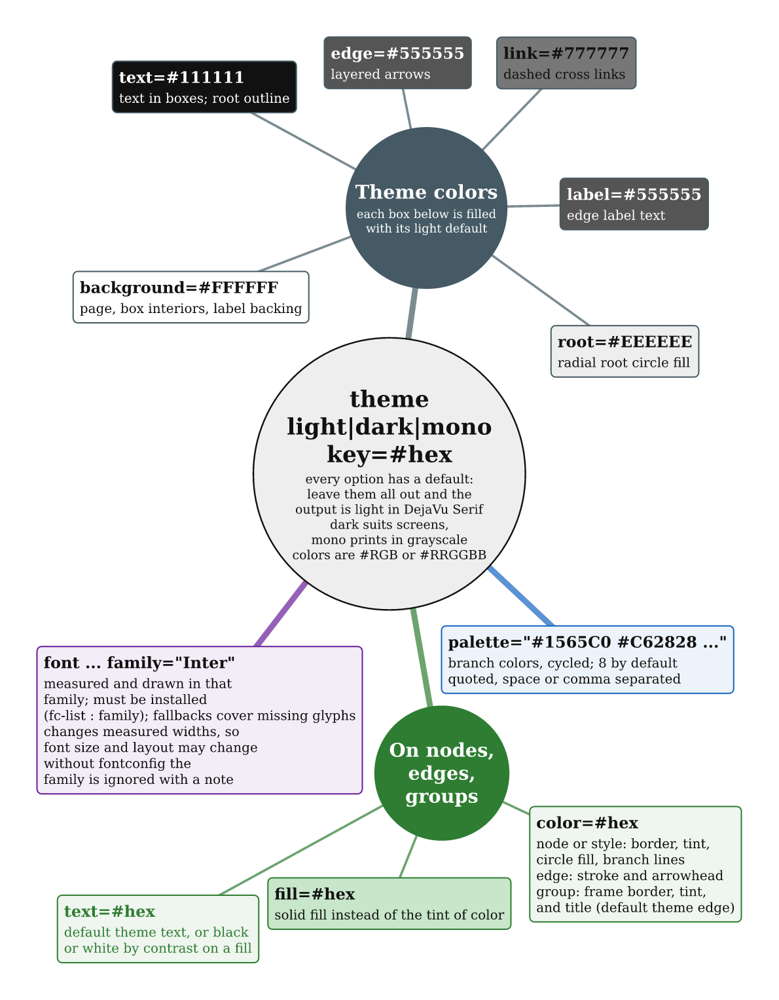
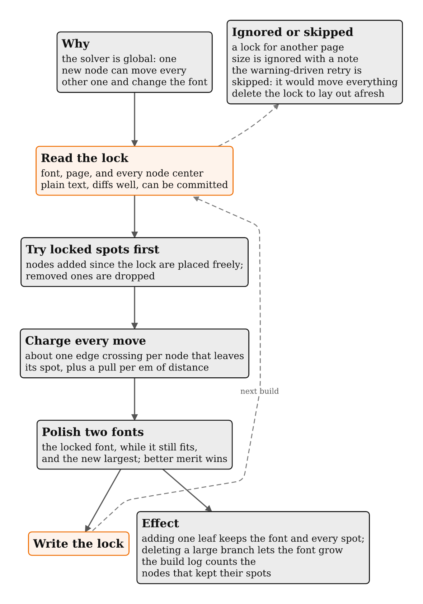
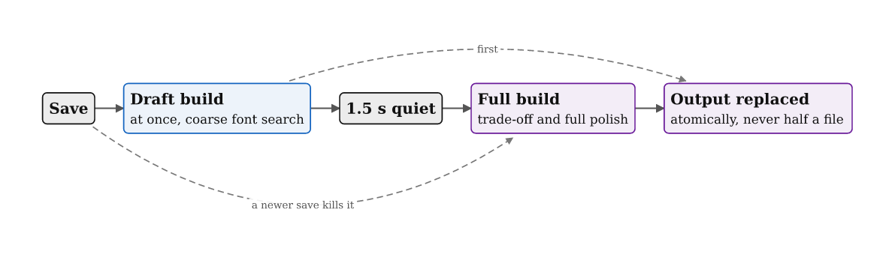
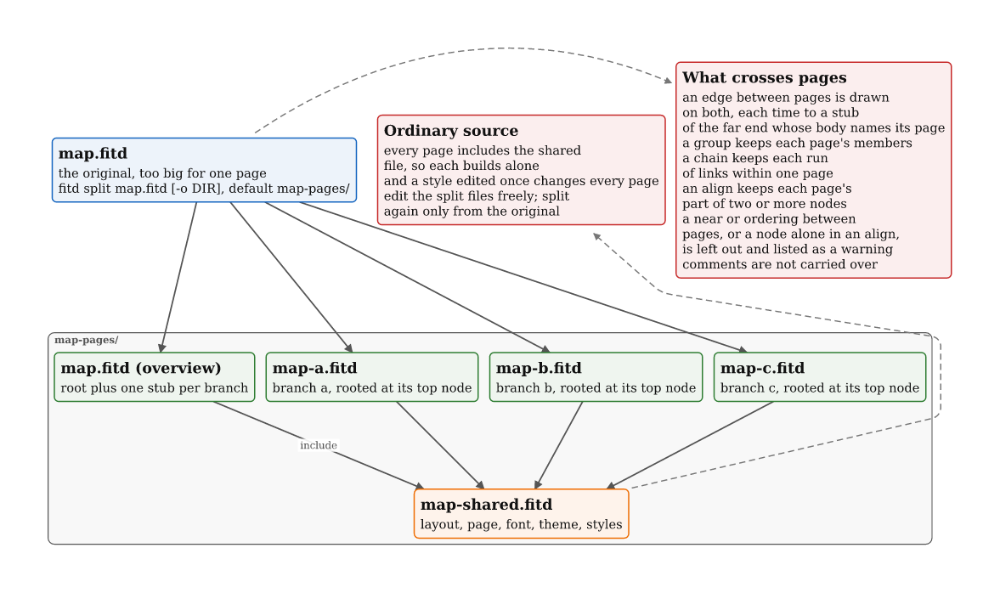

# Options

```
fitd FILE.fitd [-o out.svg|.png|.pdf] [--tikz out.tex] [--page a4|WxHmm] [flags]
fitd A.fitd B.fitd -o book.pdf
fitd - -o out.svg < map.fitd
fitd split map.fitd
```

Flags override settings written in the file. Set `FITD_DEBUG=1` to trace each solver probe. Exit code 0 means output was written; diagnostics go to stderr, one line each with `--short`.

## Flags and subcommands

Output: `-o` picks the format by extension (SVG is page-sized, PNG is cropped to the drawing, PDF keeps text selectable). Several inputs with a PDF output make one page per input. `--tikz` also writes standalone LaTeX. `--force` writes output despite checker errors.

![fitd FILE [flags]](options/01-options.png)

Source: [01-options.fitd](options/01-options.fitd)

## Theming

Every theme option has a default. `theme dark` suits screens, `theme mono` prints in grayscale; individual keys (`background`, `text`, `edge`, `link`, `label`, `root`, `palette`) override the preset. On nodes, edges, and groups, `color`, `fill`, and `text` set border, solid fill, and text color. `family=` needs the font installed, and changes measured widths.



Source: [02-theming.fitd](options/02-theming.fitd)

## --stable

Adding one node to a global solver can move everything. `--stable map.fitd.lock` stores font, page, and node centers, tries those spots first, and charges for every move, so adding a leaf keeps the font and every position. The lock is plain text and diffs well. A lock for another page size is ignored with a note.



Source: [03-stable.fitd](options/03-stable.fitd)

## --watch

`fitd map.fitd --watch` rebuilds on save: a coarse draft first, then the full build after 1.5 s of quiet. A newer save cancels a running full build. Output is replaced atomically.



Source: [04-watch.fitd](options/04-watch.fitd)

## fitd split

`fitd split map.fitd [-o DIR]` writes a shared settings file, an overview page, and one page per branch, all ordinary source that includes the shared file. Edit them freely; split again only from the original. Edges between pages are drawn on both with a stub naming the far page. Constraints that span pages are left out and listed as warnings.



Source: [05-split.fitd](options/05-split.fitd)
