# Examples

Every image is built from the `.fitd` file linked above it. The tests rebuild the showcase and docs images and fail if they are stale.

## Language

Radial maps, layered flows, macros, includes, and a user library.

### [fitd_language.fitd](fitd_language.fitd)

fitd described in fitd: one of each kind of statement, in a small diagram.

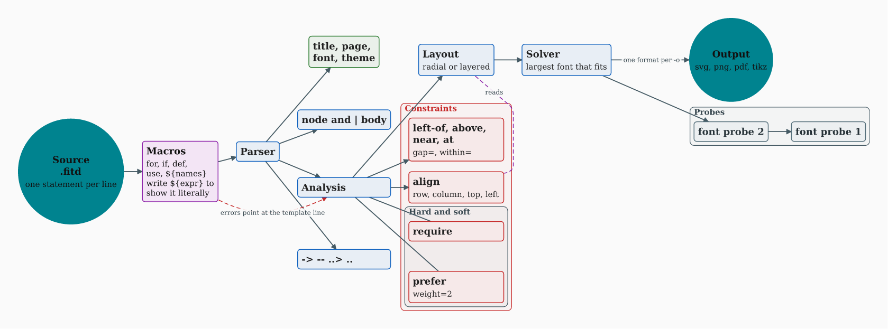

### [compiler.fitd](compiler.fitd)

The fitd pipeline itself, as a layered flowchart with layout constraints.

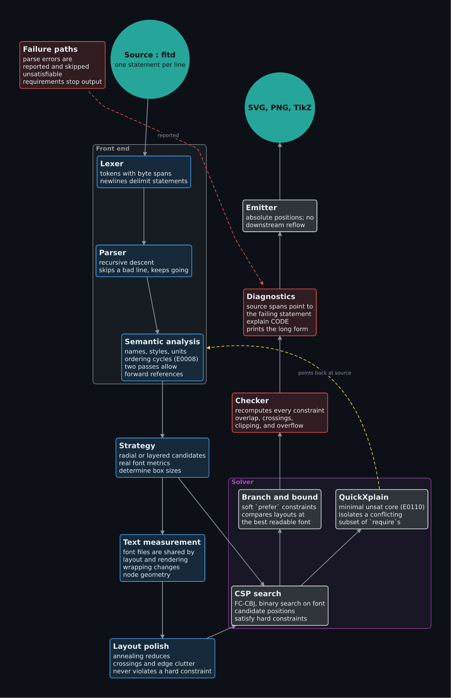

### [coffee.fitd](coffee.fitd)

From cherry to cup: a radial map whose center fitd picks, colored by a custom palette.

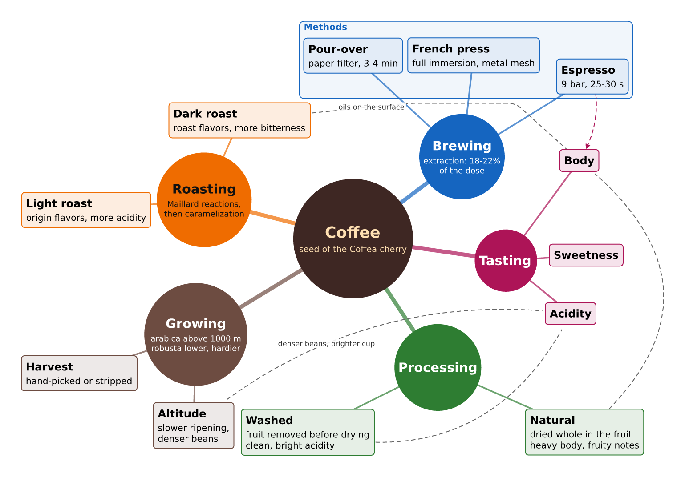

### [group_theory.fitd](group_theory.fitd)

Introductory group theory: cyclic and permutation groups, cosets and Lagrange, isomorphisms and products.

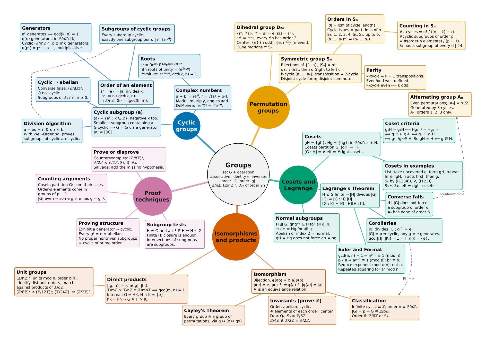

### [oncall.fitd](library/oncall.fitd)

On-call flow built from a user library beside this file.

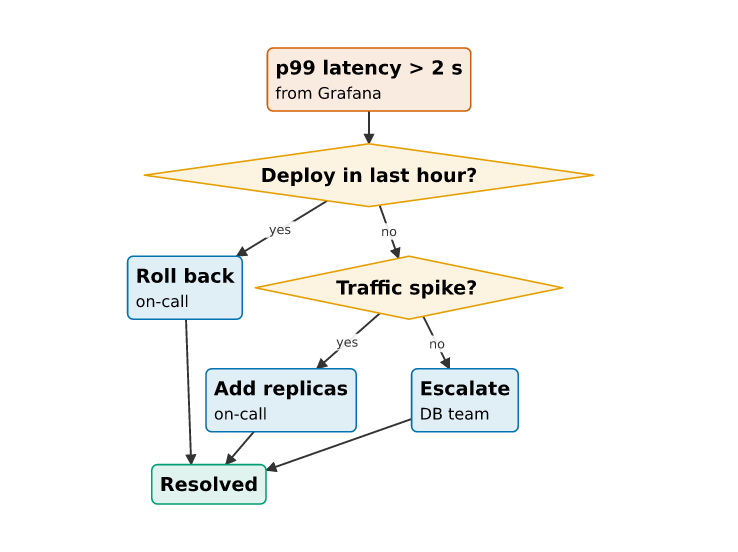

## Showcase

Several standard-library modules in one figure.

### [01-incident-review.fitd](showcase/01-incident-review.fitd)

Incident review: arch (the system), time (the outage), flow (the response) in one page.

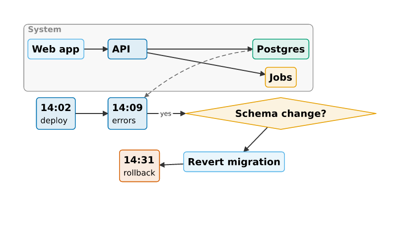

### [02-model-confusion.fitd](showcase/02-model-confusion.fitd)

A results page: model diagram, confusion matrix, and a Venn of error overlap together.

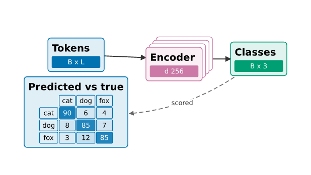

### [03-domain-model.fitd](showcase/03-domain-model.fitd)

A domain model: UML classes, inheritance and composition, persisted into an arch store.

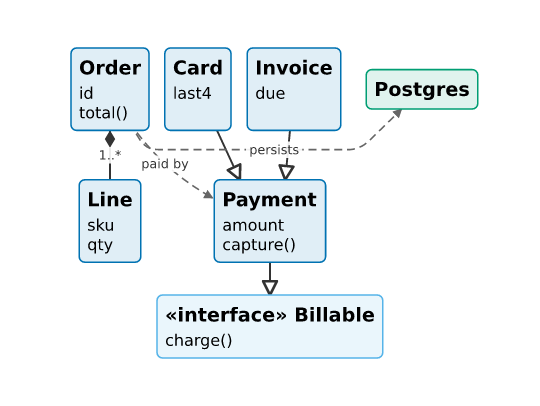

### [04-triage.fitd](showcase/04-triage.fitd)

A triage guide: a decision tree whose leaves hand off to flowchart steps.

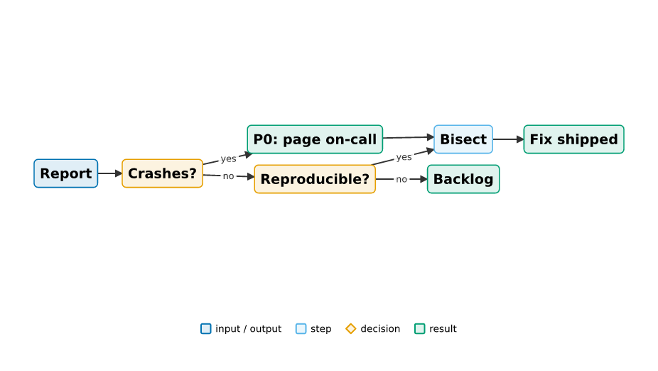

## Gallery

One figure per common academic diagram type.

### [01-flowchart.fitd](gallery/01-flowchart.fitd)

Flowchart (DocFigure, Nickerson: tight genre). std/flow gives the role colours.

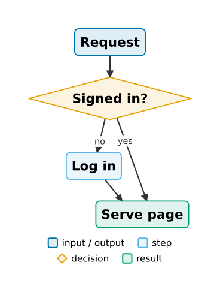

### [02-architecture.fitd](gallery/02-architecture.fitd)

Architecture / block diagram (Nickerson: 212 of 983, the largest genre; DocFigure block diagram).

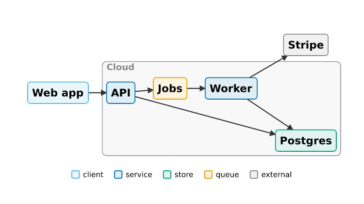

### [03-neural-network.fitd](gallery/03-neural-network.fitd)

Neural-network architecture (ACL-Fig: neural networks, architecture diagram).

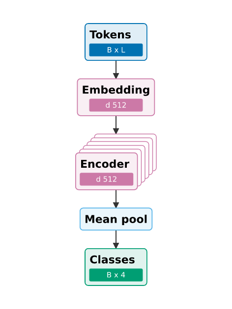

### [04-org-chart.fitd](gallery/04-org-chart.fitd)

Tree / hierarchy, here an org chart (DocFigure tree diagram; ACL-Fig trees).

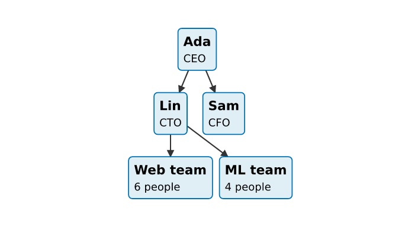

### [05-syntax-tree.fitd](gallery/05-syntax-tree.fitd)

Syntax tree (ACL-Fig: NLP grammar examples, trees).

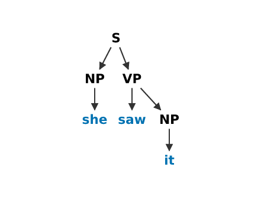

### [06-decision-tree.fitd](gallery/06-decision-tree.fitd)

Decision tree (ML papers, clinical guidelines).

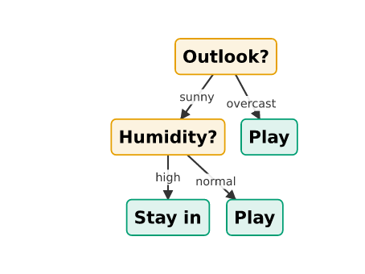

### [07-network.fitd](gallery/07-network.fitd)

Network graph (Lohse et al.: networks; ACL-Fig: graph). Radial layout, no library needed.

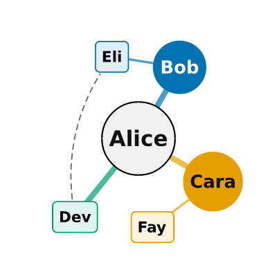

### [08-confusion-matrix.fitd](gallery/08-confusion-matrix.fitd)

Confusion matrix / heat map (DocFigure: confusion matrix, heat map; ACL-Fig: confusion matrix).

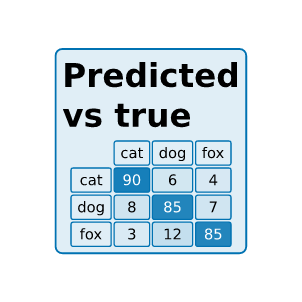

### [09-table.fitd](gallery/09-table.fitd)

Results table (DocFigure, ACL-Fig: tables).

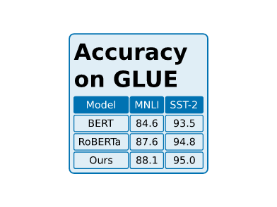

### [10-research-model.fitd](gallery/10-research-model.fitd)

Research model with hypotheses (Nickerson: models, 101 of 983).

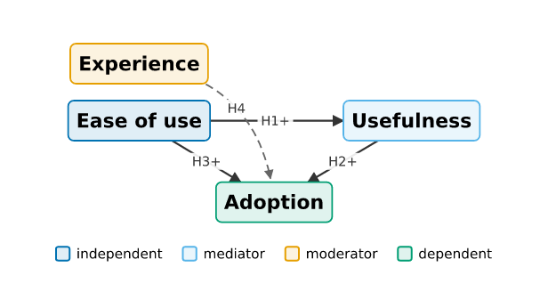

### [11-data-flow.fitd](gallery/11-data-flow.fitd)

Data-flow diagram (Nickerson: flow, 80 of 983).

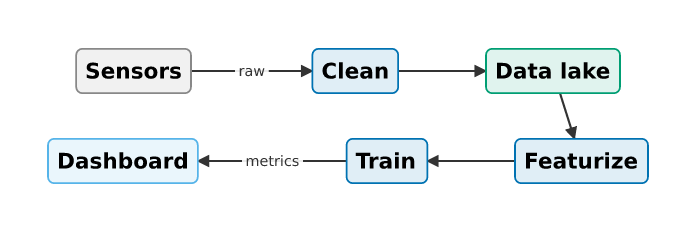

### [12-layer-stack.fitd](gallery/12-layer-stack.fitd)

Layer / stack diagram (Nickerson: layers).

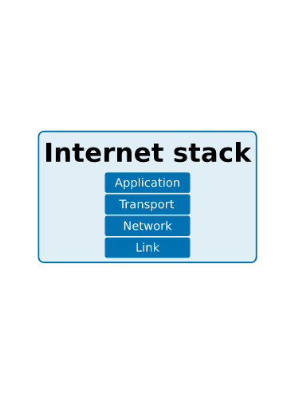

### [13-cycle.fitd](gallery/13-cycle.fitd)

Stage cycle (Nickerson: research or method stages drawn as cycles). A back link closes the loop.

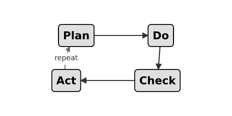

### [14-uml-class.fitd](gallery/14-uml-class.fitd)

UML class diagram (Reggio et al.: most used UML diagram; Nickerson: most common UML type).

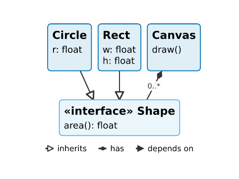

### [15-state-machine.fitd](gallery/15-state-machine.fitd)

UML state machine (Reggio et al.: state machine among the core UML diagrams).

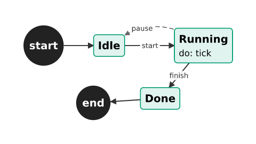

### [16-er.fitd](gallery/16-er.fitd)

Entity-relationship diagram (Nickerson: ERD, static structure).

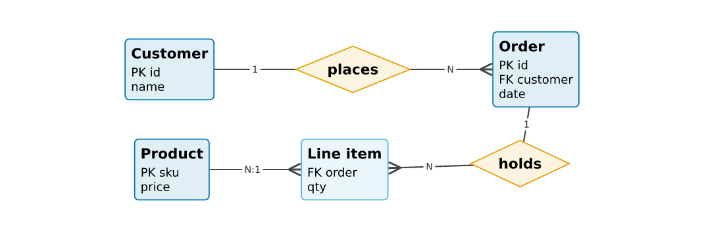

### [17-timeline.fitd](gallery/17-timeline.fitd)

Timeline (history, project reports).

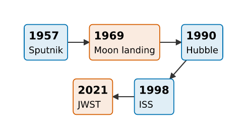

### [18-gantt.fitd](gallery/18-gantt.fitd)

Gantt chart (project plans, grant proposals).

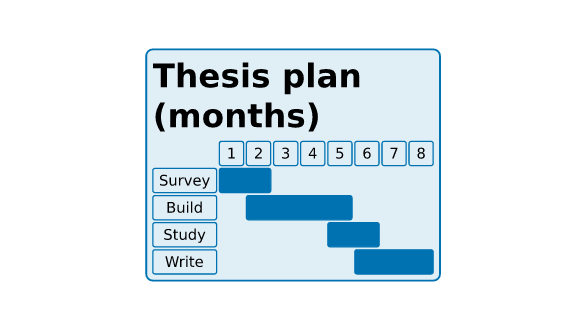

### [19-mind-map.fitd](gallery/19-mind-map.fitd)

Mind map / concept map (education). Radial is the default layout.

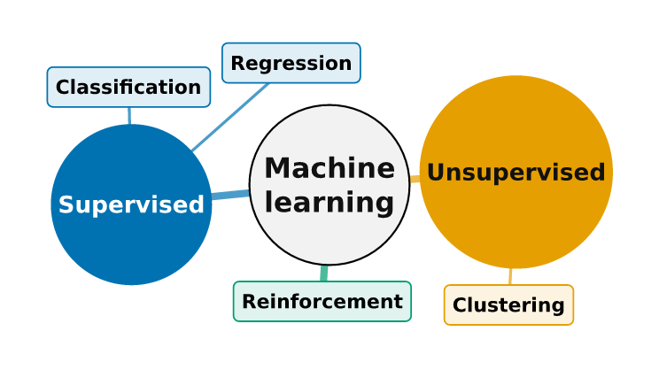

### [20-swot.fitd](gallery/20-swot.fitd)

2x2 matrix such as SWOT (business, strategy), with nodes placed on a grid.

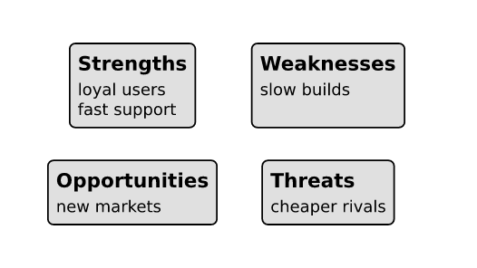

### [21-bar-chart.fitd](gallery/21-bar-chart.fitd)

Unit bar chart (DocFigure: bar plot). Only small counts; real plots belong to a plotting tool.

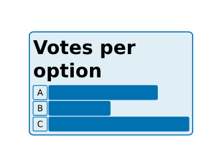

### [22-commutative.fitd](gallery/22-commutative.fitd)

Commutative diagram (mathematics): a square placed on a grid.

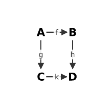

### [23-fishbone.fitd](gallery/23-fishbone.fitd)

Cause-and-effect (Ishikawa) diagram (quality management), drawn as a tree into the effect.

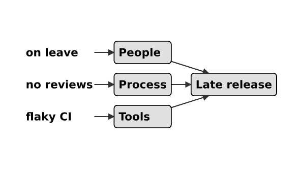

### [24-swimlane.fitd](gallery/24-swimlane.fitd)

Swimlane activity diagram (Reggio et al.). Each group is a lane, in declaration order.

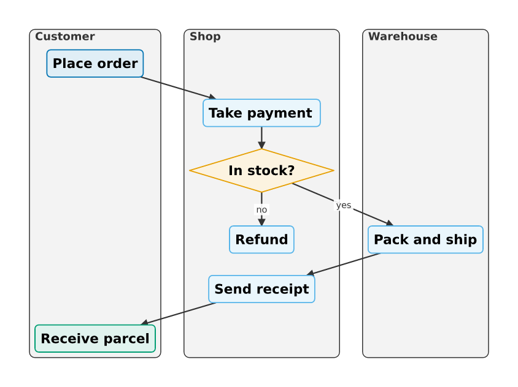

### [25-sequence.fitd](gallery/25-sequence.fitd)

UML sequence diagram (Reggio et al., Nickerson: second UML type). Lanes keep message order.

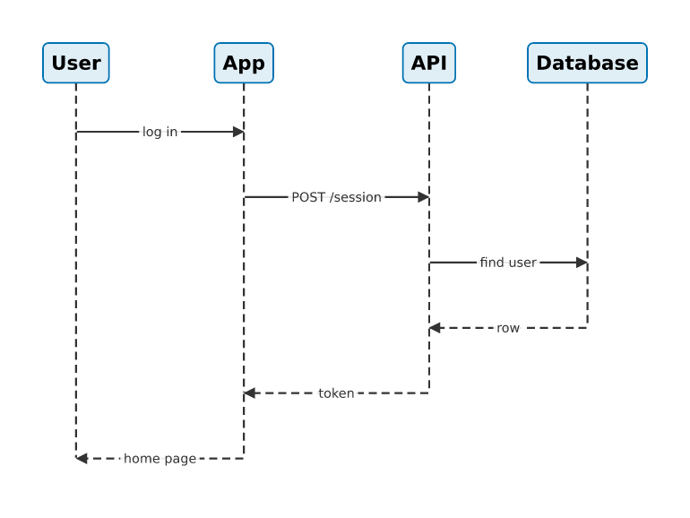

### [26-venn.fitd](gallery/26-venn.fitd)

Venn diagram of two sets (concept overlap, comparisons).

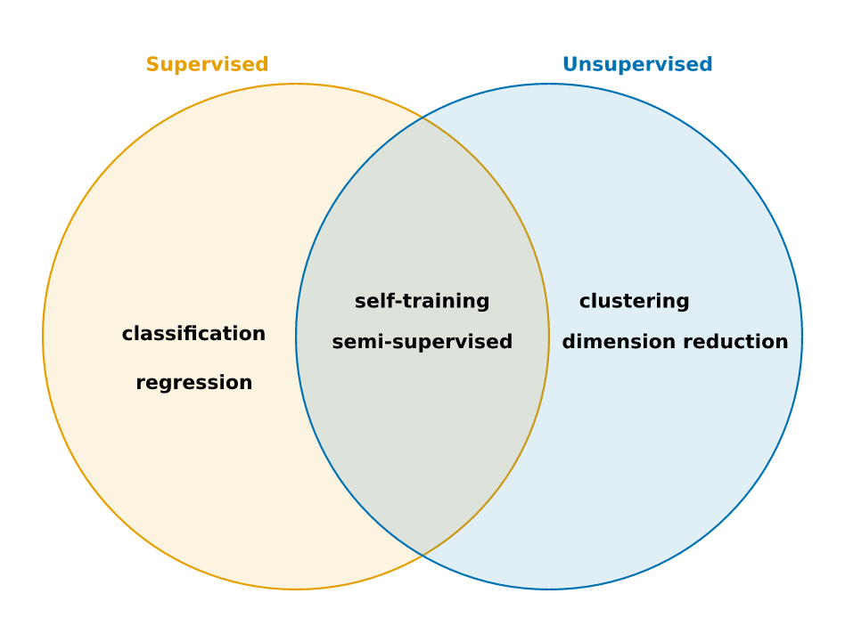

### [27-venn-three.fitd](gallery/27-venn-three.fitd)

Venn diagram of three sets, every overlap labelled (skills, feature comparisons).

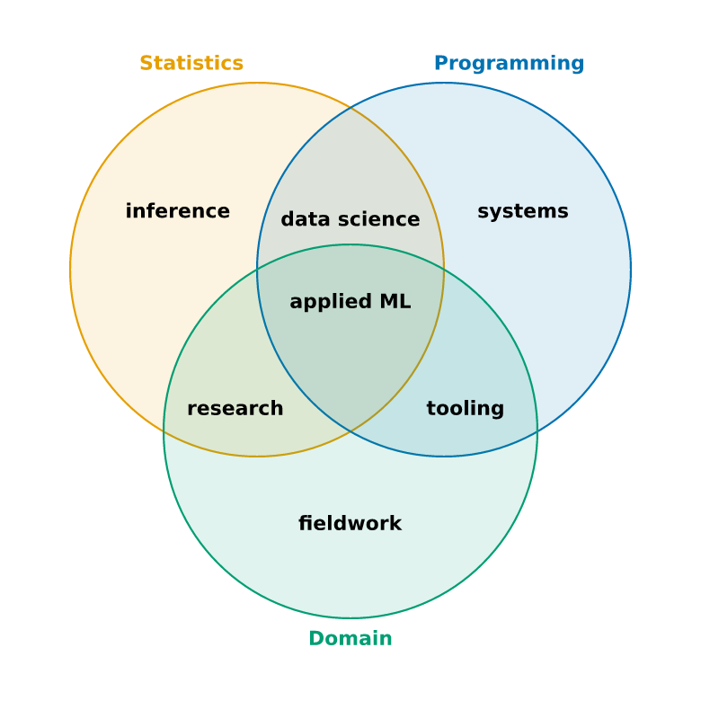

### [28-algorithm.fitd](gallery/28-algorithm.fitd)

Algorithm block (DocFigure and ACL-Fig: "algorithm" class).

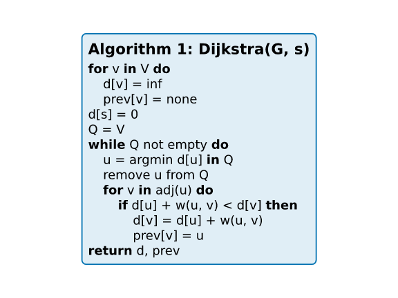

### [29-image.fitd](gallery/29-image.fitd)

Mixed figure: a plot inside a pipeline (Viziometrics, DocFigure, ACL-Fig mix plots and diagrams).

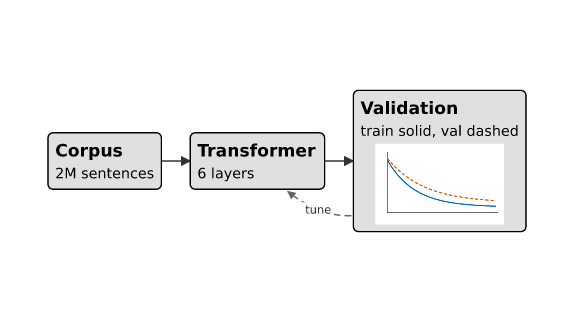
